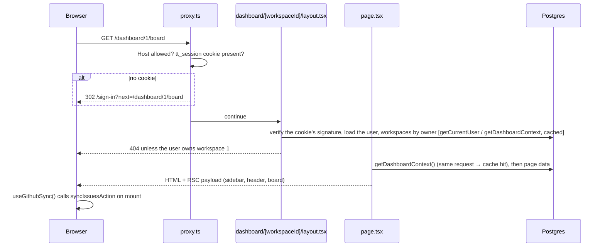

# Architecture

How the app is put together. For coding conventions and the design system, see [AGENTS.md](../AGENTS.md).

- [Stack](#stack)
- [Folder structure](#folder-structure)
- [Routes](#routes)
- [Request flow](#request-flow)
- [Authentication and sessions](#authentication-and-sessions)
- [Authorization](#authorization)
- [Server and client boundary](#server-and-client-boundary)
- [Data access and mutations](#data-access-and-mutations)
- [Styling and theming](#styling-and-theming)
- [External services](#external-services)

---

## Stack

| Concern | Choice | Why / notes |
| --- | --- | --- |
| Framework | **Next.js 16.4** (App Router, Turbopack), **React 19** | Server Components by default; Server Actions for mutations. Next 16 renames `middleware.ts` to `proxy.ts`. Its docs ship in `node_modules/next/dist/docs/` — read them, APIs differ from older versions. |
| Language | **TypeScript 5**, `strict` | Path alias `@/*` → project root. |
| Styling | **Tailwind CSS v4** (CSS-first config) | All tokens in `app/globals.css`; there is no `tailwind.config`. |
| UI primitives | **shadcn/ui** (`base-nova` style) on **`@base-ui/react`** | Not Radix: compose with the `render` prop, not `asChild`. Generated into `components/ui/`. |
| Icons | `lucide-react` | Import `…Icon` names (`RocketIcon`). |
| Font | **Plus Jakarta Sans** via `next/font` | Exposed as `--font-sans`. |
| Theme | `next-themes` | Toggles the `dark` class on `<html>`; light by default, light/dark/system in the user menu. |
| Database | **PostgreSQL** + **Drizzle ORM** (`postgres` driver) | Embedded Postgres 18 started by `npm run dev` (`embedded-postgres`, `scripts/local-db.mjs`) when `DATABASE_URL` is unset, else your own. Schema in `db/schema.ts`; SQL migrations in `drizzle/` (`db:generate`, `db:migrate`). |
| Auth | **GitHub device flow** (or a personal access token); stateless signed cookie | `lib/device-flow.ts`, `lib/sign-in.ts`, `lib/session.ts`. No remote auth service, no client secret. |
| GitHub | OAuth App (public client id) + REST API v3 (`2022-11-28`) | Plain `fetch` in `lib/github.ts`; no Octokit. |
| File storage | Local disk (`TECHTEAM_DATA_DIR`) | Workspace logos, the Tester's screenshots and card references, in `files/`. |
| Background jobs | **Inngest** v3 | Durable functions served at `/api/inngest`. |
| Agent sandboxes (optional) | **Docker** + **gVisor** on a Docker host (a VPS today) | The `docker` CLI over SSH (`SANDBOX_DOCKER_HOST`), no SDK; throwaway containers per call (`lib/sandbox/`). See [sandbox.md](sandbox.md). |
| Drag and drop | `@dnd-kit/core` 6 + `@dnd-kit/sortable` 10 | Stable API (not the 0.x `@dnd-kit/react`). |
| Dates | `date-fns` | |
| Quality | **ESLint 9** (flat config, `eslint-config-next`), **Vitest 4** | `npm run check` = typegen + `tsc` + lint + unit tests; CI on Linux and Windows. |

## Folder structure

```
app/                         Routes (App Router)
  (auth)/                    Sign-in and sign-in/adopt — route group, no URL segment
    actions.ts               startGithubSignIn, pollGithubSignIn, cancelGithubSignIn, signInWithToken, adoptExistingData, createSeparateAccount, signOut
  api/                       Route handlers (binary responses, Inngest, MCP)
  dashboard/                 /dashboard and /dashboard/[workspaceId]/…
    [workspaceId]/
      layout.tsx             Dashboard shell: sidebar + header; owner check
      actions.ts             getTeamStatusAction (live team + live process), getNotificationsAction, markNotificationsReadAction
      board/actions.ts       Board server actions
  workspaces/                Workspace picker and create flow
    actions.ts               createWorkspace, disconnectGithub
  globals.css                Theme: palette, semantic tokens, elevation, surface utilities
  layout.tsx                 Root layout: font, ThemeProvider
  page.tsx                   `/`: redirects to /dashboard (signed in) or /sign-in
components/
  ui/                        shadcn primitives (generated; restyle via tokens)
  auth/                      Sign-in UI (device-flow states, personal-token form), brand icons, FormMessage
  workspace/                 Workspace avatar, create form, icon/logo picker, repo picker, draft storage
  dashboard/                 Shell (sidebar, switcher, header, user menu) and page building blocks
  board/                     Kanban board, cards, columns, dialog, filters, GitHub sync UI, agent log panel,
                             out-of-credit notice
  ai-team/                   AI Team: agent cards (faces, live working state), configure dialog, trust, spend and
                             skills panels, live process (six steps per card in flight), live team polling
  skills/                    Agent skills UI: Settings library + upload, badges, findings, agent checkboxes
  settings/                  Settings forms: automation, API keys, Claude plan, fallback order, sandbox (commands + Test the sandbox)
  app-header.tsx, brand.tsx  Top bar for /workspaces pages; product mark + APP_NAME
db/
  schema.ts                  Drizzle schema (all tables)
  index.ts                   Drizzle client (`db`) + re-exports of the schema
hooks/                       Client hooks (use-field-errors, use-mobile)
lib/                         Server logic (most files start with `import "server-only"`)
  session.ts, session-config.ts  Signed session cookie (`tt_session`), sealed short-lived cookies; cookie names
  secrets.ts                 Encryption key and session secret (env, else files in the data dir)
  device-flow.ts, sign-in.ts GitHub device flow (pure state machine) and the server side of sign-in
  user-identity.ts, local-user.ts  Which user a GitHub id is (pure rules) and the database side
  host-guard.ts, safe-redirect.ts  Host header check (proxy.ts), post-sign-in redirect check
  current-user.ts            getCurrentUser(), requireUser(returnTo)
  workspaces.ts              Owner-scoped workspace queries, getDashboardContext()
  github.ts                  GitHub REST calls, connection persistence
  github-issues.ts           GitHub issue → board sync
  board.ts                   Board persistence and validation
  board-config.ts            Board vocabulary shared by server and client (no server-only)
  crypto.ts                  AES-256-GCM encrypt/decrypt
  ai-keys.ts                 AI provider keys on the account (encrypted; environment fallback), verification, masking
  storage.ts                 Local file uploads, reads and deletes
  reference-config.ts        Card references: kinds, limits, type by magic bytes, image size, what agents read (pure, shared)
  references.ts              Card references: upload (file + PDF text), list, remove, delete with the card; agent reads
  reference-images.ts        Reference images as model input per provider, placeholders hydrated from local storage (pure)
  reference-pdf.ts           PDF text at upload (unpdf, page and character caps)
  agents.ts                  Agents persistence, team view, activity/spend ledger, task key prefix
  agent-config.ts            Agent roles, permissions, models (shared client/server)
  agent-trust.ts             Trust Score rule scan, incl. enabled skills' scan findings (pure)
  agent-skills-config.ts     Agent skills vocabulary: types, loads, sources, limits, metadata keys, scan type (shared)
  agent-skills.ts            Skill library + assignments, ensureBuiltinSkills, the agent's skills for prompt and tools
  builtin-skills.ts          Built-ins: agent-skills/catalog.json + reading their files from disk
  skill-format.ts            SKILL.md frontmatter parsing/validation, safe paths, search metadata, content version (pure)
  skill-zip.ts               Defensive ZIP reader on node:zlib (size caps, CRC, no links/ZIP64/encryption)
  skill-package.ts           An upload → validated skill package (limits, text files only)
  skill-scan.ts              Deterministic security rules for uploaded skills (pure)
  skill-runtime.ts           Skills prompt block, search ranking, paginated reads (pure)
  skill-install.ts           Upload inspect/install (sealed token), new versions, assignments, delete
  agent-ai.ts                Config AI (OpenAI, else Anthropic, else OpenRouter): instruction drafting, AI trust review
  agent-run-config.ts        Pipeline phases and agent stages, run statuses, report types, risk floor, merge
                             decision (shared client/server)
  live-process.ts            Live process mapping: a run in flight → six steps (pure, shared client/server)
  agent-runs.ts              agent_runs persistence, card placement, auto-pickup query
  agent-pipeline.ts          Stage work: prompts, stage start/turns, branch, PR, review/security/approval/test recording
  agent-loop.ts              One model turn with function tools (OpenAI Responses, Anthropic Messages or OpenRouter
                             Chat Completions)
  agent-simulated.ts         Scripted agents for AGENTS_SIMULATED=true
  agent-tools.ts             Agent tools on the GitHub API, gated by stage and permissions; search_skill/read_skill;
                             list_references/read_reference; the merge tools
  repo-paths.ts              Which paths agents may write (protected paths, manifests, lockfiles)
  branch-merge.ts            merge_default_branch and conflict resolution through the Git Data API
  merge-config.ts, diff3.ts  Pure: the merge's tree plan, rules, answers and briefs; the three-way line merge
  pull-requests.ts           Agent PRs: merge, Tester follow-up on conflicts/failing builds, runs that continue a PR
                             (createCardRun), refresh, list
  openai.ts                  OpenAI client and cost accounting
  anthropic.ts               Anthropic client, cost accounting, tool schema conversion
  openrouter.ts              OpenRouter client (Chat Completions), routing rules, reported cost, out-of-credit
  overview.ts                Overview data: stats and upcoming tasks from the board, recent work activity
  activity.ts                Workspace activity feed (agent_activity + cards people created)
  notifications.ts           Header bell: notify(), list, mark read
  workspace-icons.ts         Selectable workspace icons (shared client/server)
  inngest/                   Inngest client and functions: agent pipeline, auto pickup, run sweep, preview sweep
  doctor/, backup/           Plain .mjs behind npm run doctor / backup / restore (checks and probes; archive, registry of secret columns)  local-db-config.mjs, local-stack-config.mjs  Embedded database settings (data dir, port, secret) and start:local's ports and build decision  setup.ts, setup-status.ts  The Get started checklist (server facts, pure steps)  run-sweep.ts, run-recovery-config.ts  Ends runs left behind when TechTeam stopped (rules pure and tested)  cli/, cli-agents-config.ts, mcp-protocol.ts  Agents on your Claude plan: Claude Code, its MCP endpoint, route rules
  local-db-config.mjs, local-stack-config.mjs  Embedded database settings (data dir, port, secret); start:local's ports and build decision
  setup.ts, setup-status.ts  The Get started checklist (server facts, pure steps)
  run-sweep.ts, run-recovery-config.ts  Ends runs left behind when TechTeam stopped (rules pure and tested)
  cli/, cli-agents-config.ts, mcp-protocol.ts  Agents on your Claude plan: Claude Code, its MCP endpoint, route rules
  sandbox/                   Agent sandboxes: config.ts (pure: commands, detection, report), docker.ts (containers
                             over the docker CLI, sweep), index.ts (repo commands for runs and the Settings check)
  utils.ts                   cn(), initials()
proxy.ts                     Optimistic auth guard for /dashboard and /workspaces
drizzle.config.ts            drizzle-kit config (public schema only)
docs/                        This documentation
drizzle/                     SQL migrations + snapshots (generated; 0000_baseline = schema as of 2026-11)
test/                        Test helpers (server-only stand-in); tests live next to their modules (*.test.ts)
scripts/                     doctor.mjs, start-local.mjs, local-db.mjs, backup.mjs, restore.mjs, import-s3.mjs, db-baseline.mjs,
                             sync-agent-skills.mjs, cli-isolation-check.mts (the npm run commands; logic in lib/doctor, lib/backup)
deploy/                      setup.sh: prepares a fresh Ubuntu 24.04 VPS as the sandbox host (idempotent)
agent-skills/                Built-in skills vendored at pinned commits (sources.json, catalog.json, <slug>/)
public/                      agents/<key>.webp: one face per agent role
AGENTS.md / CLAUDE.md        Conventions for contributors and AI agents (CLAUDE.md just imports AGENTS.md)
```

## Routes

### Pages

| Path | Auth | What it is |
| --- | --- | --- |
| `/` | public | Redirects to `/dashboard` when signed in, else `/sign-in` (no landing page yet). |
| `/sign-in` | public | "Continue with GitHub" (device flow: code, Open GitHub, waiting) and a personal-token form. Signed-in visitors are redirected to `next` or `/workspaces`. |
| `/sign-in/adopt` | pending sign-in | Asked once: adopt the database's existing data with this GitHub account, or create a separate account. |
| `/workspaces` | signed in | Workspace picker — the landing page after sign-in. Redirects to `/workspaces/new` if you have none. |
| `/workspaces/new` | signed in | Create a workspace. |
| `/dashboard` | signed in | Redirects to the newest workspace's dashboard, or to `/workspaces/new`. |
| `/dashboard/[workspaceId]` | owner | Overview. |
| `/dashboard/[workspaceId]/board` | owner | Kanban board. `?log=<card id>` opens that card's agent log. |
| `/dashboard/[workspaceId]/ai-team` | owner | AI Team: agents, configure dialog, trust score, spending, activity. |
| `/dashboard/[workspaceId]/pull-requests` | owner | Agent pull requests (refreshed from GitHub on load), review/test verdicts, **Merge**. |
| `/dashboard/[workspaceId]/activity` | owner | Workspace activity timeline (`?show=` for older events). |
| `/dashboard/[workspaceId]/settings` | owner | Your account: profile (`#account`), AI (`#ai`: Claude plan on this computer, account keys, models, then this workspace's automatic switch and fallback order), spending across projects (`#usage`). This workspace: details (`#workspace`), automation (`#agents`), Sandbox (`#sandbox`), Agent skills summary (`#skills`). |

"owner" = signed in **and** owner of that workspace; anything else is a 404.

### Route handlers

| Path | Method | Purpose |
| --- | --- | --- |
| `/api/workspaces/[id]/logo` | GET | Streams a workspace logo from local storage to its owner. |
| `/api/inngest` | GET/POST/PUT | Inngest `serve()` endpoint (function registry and execution). |
| `/api/mcp/runs/[runId]` | POST | TechTeam's MCP endpoint for a CLI agent's stage (local only; bearer derived per run, stage and round): the stage's tools over Streamable HTTP, stateless. See [cli-agents.md](cli-agents.md). |

### Server actions

| File | Actions |
| --- | --- |
| `app/(auth)/actions.ts` | `startGithubSignIn`, `pollGithubSignIn`, `cancelGithubSignIn`, `signInWithToken`, `adoptExistingData`, `createSeparateAccount`, `signOut` |
| `app/workspaces/actions.ts` | `createWorkspace`, `disconnectGithub` |
| `app/dashboard/[workspaceId]/actions.ts` | `getTeamStatusAction`, `getNotificationsAction`, `markNotificationsReadAction` |
| `app/dashboard/[workspaceId]/board/actions.ts` | `createCardAction`, `updateCardAction`, `moveCardsAction`, `removeCardAction`, `runCardAction`, `answerCardAction`, `stopCardAction`, `mergeCardAction`, `switchProviderAndRetryAction`, `getRunLogAction`, `syncIssuesAction`, `getBoardAction` |
| `app/dashboard/[workspaceId]/ai-team/actions.ts` | `saveAgentAction`, `scanAgentAction`, `generateAgentAction`, `setAgentSkillAction` |
| `app/dashboard/[workspaceId]/pull-requests/actions.ts` | `mergePullRequestAction` |
| `app/dashboard/[workspaceId]/settings/actions.ts` | `saveAutomationAction`, `saveSandboxAction`, `checkSandboxAction`, `saveAutoFailoverAction`, `saveProviderKeyAction`, `removeProviderKeyAction`, `saveFallbackOrderAction`, `refreshModelsAction`, `claudePlanAction`, `savePlanLimitAction`, `inspectSkillAction`, `installSkillAction`, `saveSkillAssignmentsAction`, `deleteSkillAction` |

Server Actions are POST endpoints. Each one re-checks the session and ownership itself; never assume the page that
rendered the form already did.

## Request flow



- `proxy.ts` refuses a foreign `Host` (DNS rebinding) and checks that the cookie **exists** (cheap, runs on every request).
  The cookie itself is verified by `getCurrentUser()`.
- `getCurrentUser()` and `getDashboardContext()` are wrapped in React `cache()`, so a layout and its page share one user
  lookup and one set of queries per request.
- All dashboard pages are dynamic (they read cookies), so they re-render on every navigation — no
  `revalidatePath` is needed after mutations.

## Authentication and sessions

Sign-in is GitHub only and is also repository access; nothing remote besides GitHub is involved.

**Device flow** (`lib/device-flow.ts`, pure with an injected `fetch`; `lib/sign-in.ts`):

1. "Continue with GitHub" calls `startGithubSignIn`: `POST github.com/login/device/code` (client id and scope
   `repo read:user`, no secret). The page gets only the `user_code` and `verification_uri`; the device code goes into
   the sealed httpOnly `tt_login` cookie, which lives as long as the code.
2. The owner opens github.com/login/device and types the code. Meanwhile the page calls `pollGithubSignIn` after the
   interval the server returns; the server polls `/login/oauth/access_token`, respecting `interval` and `slow_down`
   (+5 s) and stopping on `expired_token`, `access_denied` and `device_flow_disabled`.
3. On success: `GET /user` → `resolveGithubSignIn` finds, links or creates the `users` row → `saveGithubConnection`
   stores the encrypted token (refreshed on every sign-in) → `startSession` sets `tt_session` → the page goes to `next`.

A **personal access token** pasted in the secondary form is verified (`GET /user` and a repository listing) and then
follows step 3.

**Which user** (`resolveUser`, pure, tested; `lib/local-user.ts` runs it under a Postgres advisory lock so two sign-ins
can't create two rows): a user with that `github_user_id`; else a user whose saved `github_connections` row has that id
(gets the id); else, if the database has exactly one user, `/sign-in/adopt` asks before handing them this account (the
pending sign-in, token included, waits in the sealed and encrypted `tt_adopt` cookie); else a new user
(email `<id>+<login>@users.noreply.github.com`).

**Session cookie** — `tt_session` = `<userId>.<expiresAtMs>.<hmac>`: HMAC-SHA256 with the secret in
`<data dir>/session.secret`, HTTP-only, `SameSite=Lax`, 30 days, `Secure` only for an https `NEXT_PUBLIC_APP_URL`.
No table, no remote call, no cache. Signing out (and "Disconnect") clears the cookie.

**Local only** — the app listens on `127.0.0.1`; `proxy.ts` answers 403 to any other `Host`. The app calls itself
(Inngest, the CLI agents' MCP endpoint) at `127.0.0.1`, because `localhost` can resolve to `::1` first.

## Authorization

- `requireUser(returnTo)` (pages and actions) — redirects to `/sign-in?next=returnTo` when signed out.
- `getCurrentUser()` (route handlers) — returns `null` instead of redirecting.
- Every workspace id that comes from a request goes through an **owner-scoped** query: `getOwnedWorkspace(ownerId, id)`
  or `getDashboardContext(workspaceIdParam)` (404 when not the owner).
- Board mutations re-check that every card id belongs to the workspace (`reorderTasks` rejects the whole move if one
  id doesn't).
- A workspace has exactly one owner; there is no sharing or membership model yet.

## Server and client boundary

- **Server Components by default.** `"use client"` only where state, effects or browser APIs are needed (forms,
  the board, menus, the sidebar).
- Modules that touch the database, secrets or third-party APIs start with `import "server-only"`; client code may
  `import type` from them but never values.
- Shared constants and types that both sides need live in modules **without** `server-only`:
  `lib/board-config.ts`, `lib/workspace-icons.ts`, `components/dashboard/nav.ts`.
- Slow data is passed to the client as an un-awaited promise and unwrapped with `use()` inside `<Suspense>` (the
  repository list on `/workspaces/new`).

## Data access and mutations

- **Reads** happen in Server Components through `lib/*` functions (never inline queries in components).
- **Writes** go through Server Actions that: authorize → validate the raw input on the server → call a `lib/*`
  function → return a typed result (`{ ok: true, … } | { ok: false, error }`).
- **Optimistic UI** on the board: drag-and-drop moves render immediately and are saved in the background; failures
  roll back to a snapshot and show an inline error. Create/edit/run/remove wait for the server.
- **Concurrency**: card numbering and GitHub syncs lock the workspace row (`SELECT … FOR UPDATE`) inside a
  transaction; unique constraints back this up.

## Styling and theming

- `app/globals.css` is the single source of truth: palette (`--palette-*`) → semantic tokens (`--primary`,
  `--canvas`, `--brand-emphasis`, …) → elevation (`--elevation-*`) → Tailwind theme → surface utilities
  (`surface`, `surface-interactive`, `surface-brand`, `icon-tile`, `eyebrow`).
- The visual language is **flat**: no shadows on resting UI, hierarchy from tinted backgrounds and hairline borders.
  Only floating layers (menus, popovers, dialogs, the drag overlay) have shadows.
- Dark mode redefines tokens under `.dark`; components don't use `dark:` color overrides.

The full design system — palette table, contrast rules, typography scale, layout and component rules — is in
[AGENTS.md §6](../AGENTS.md#6-design-system).

## External services

| Service | Talks to it | Failure behavior |
| --- | --- | --- |
| GitHub | `lib/github.ts`, `lib/github-issues.ts` | `401` → "reconnect", `403/404` → "no access", others → retry later. See [github-integration.md](github-integration.md). |
| Embedded Postgres | `scripts/local-db.mjs`, `lib/local-db-config.mjs`, `db/index.ts` | Started by `npm run dev` / `start:local` when `DATABASE_URL` is unset; the app waits for its ready file. A stale lock after a hard stop is removed on the next start. |
| Local files | `lib/storage.ts` | Write errors fail workspace creation with a generic message; read errors → 404 for the logo. |
| Inngest | `lib/inngest/*`, `/api/inngest` | `send` failure → Run shows an error, the run is marked failed and nothing moves. See [background-jobs.md](background-jobs.md). |
| Sandbox host (optional; Docker over SSH) | `lib/sandbox/*` | Unset `SANDBOX_DOCKER_HOST` → Settings can't turn it on and agents get no run tools. An unreachable host or a timeout comes back to the agent as a failed run ("Failed while preparing the checkout", "Timed out…"), never as a stage error. See [sandbox.md](sandbox.md). |
| Claude Code (local CLI) | `lib/cli/*`, `/api/mcp/runs/[runId]` | Only when TechTeam runs locally. Missing, signed out or on another account → the stage takes the API key or Run refuses with the fix; a crash retries the step and resumes the session; the plan running out follows the owner's choice. See [cli-agents.md](cli-agents.md). |
