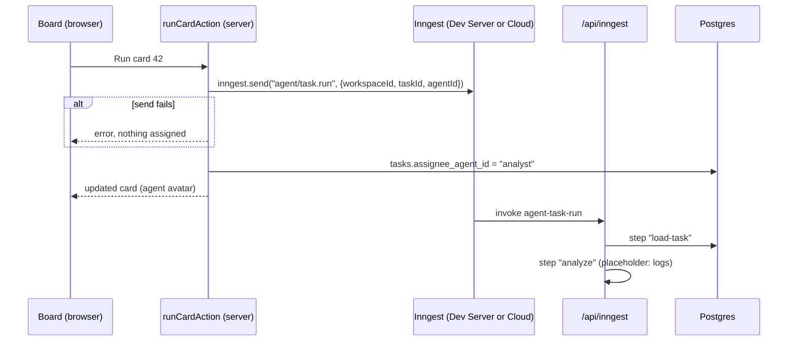

# Background jobs (Inngest)

Long-running and retryable work runs as [Inngest](https://www.inngest.com) functions, outside the request that
triggered it. Code: [`lib/inngest/`](../lib/inngest), served by [`app/api/inngest/route.ts`](../app/api/inngest/route.ts).

- [How it fits together](#how-it-fits-together)
- [Registered functions](#registered-functions)
- [agent-task-run](#agent-task-run)
- [Local development](#local-development)
- [Production](#production)
- [Adding a function](#adding-a-function)

---

## How it fits together



- The client is created in [`lib/inngest/client.ts`](../lib/inngest/client.ts) (`id: "fastnext-app"`).
- `/api/inngest` exposes the functions with `serve()` (GET = introspection, PUT = registration, POST = execution).
- Inngest calls back into the app over HTTP, so the app must be reachable from wherever Inngest runs.

## Registered functions

| Function id | Trigger | Source | Status |
| --- | --- | --- | --- |
| `agent-task-run` | event `agent/task.run` | `lib/inngest/agent-run.ts` | ⚠️ Placeholder (see below) |
| `process-task-job` | event `app/task.process` | `lib/inngest/functions.ts` | Starter-template example: two logged steps with a 2 s sleep. |
| `daily-sync-job` | cron `0 0 * * *` (daily, 00:00 UTC) | `lib/inngest/functions.ts` | Starter-template example: logs and returns `syncedRecords: 0`. |

`POST /api/inngest/trigger` is also from the starter template: it sends `app/task.process` with the request body.
It has **no authentication** — remove it or protect it before production ([security.md](security.md#known-gaps)).

## agent-task-run

Queued by the board's **Run** action (`runCardAction`). Event data: `{ workspaceId, taskId, agentId }`
(`AgentTaskRunData`).

- **Concurrency**: one run per card at a time (`concurrency: { key: "event.data.taskId", limit: 1 }`); a second Run
  on the same card waits for the first.
- **Retries**: 2.
- **Steps**:
  1. `load-task` — reads the card, scoped to the workspace and excluding removed cards. If the card was removed
     after Run was pressed, the function ends with `{ started: false }`.
  2. `analyze` — **placeholder**: logs `[agent:analyst] picked up task <id>: <title>`.

**Order of operations in `runCardAction`** — the event is sent *first*; the card is assigned only if sending
succeeded. A card is never shown as assigned to an agent that wasn't actually asked to work on it.

**Where the real agent goes** — replace the body of the `analyze` step. The workspace's repository is
`workspaces.github_repo_full_name`; get a GitHub token with `getGithubToken(workspace.ownerId)` (server-only). Keep
each external call inside its own `step.run` so retries resume where they failed.

Agents are rows in `agents` ([`lib/agents.ts`](../lib/agents.ts)); Run uses `analyst` (`RUN_AGENT_ID`) and refuses when
it's paused or over budget. The runtime should read the agent's `instructions`, `model` and `skills`, enforce the
skills as its tool list, and log spend as `task_run` rows in `agent_activity` (`logAgentActivity`, `responseCostMicros`).

## Local development

```bash
npm run dev            # app on :3000
npm run inngest:dev    # npx inngest-cli@latest dev -u http://localhost:3000/api/inngest
```

- Dev Server UI: <http://localhost:8288> — see events, runs, step output and logs; replay runs.
- No keys are needed locally. The SDK (v3) infers **Dev Mode** outside production and sends events to the Dev
  Server.
- **If the Dev Server isn't running**, the SDK falls back to Inngest Cloud with the placeholder `INNGEST_EVENT_KEY`
  and gets `401 Event key not found`. Run then fails with "Is the Inngest Dev Server running? Start it with
  `npm run inngest:dev`." — nothing is assigned.
- Force a mode with `INNGEST_DEV=1` (dev) or `INNGEST_DEV=0` (cloud).

## Production

1. Create an app in the Inngest dashboard and copy the **Event key** and **Signing key** into `INNGEST_EVENT_KEY`
   and `INNGEST_SIGNING_KEY`.
2. Deploy. In Cloud Mode `/api/inngest` verifies request signatures with the signing key.
3. Sync the app in the Inngest dashboard with `https://<your-domain>/api/inngest` (or use the Vercel integration).
4. Remove the starter-template examples (`functions.ts`, `/api/inngest/trigger`) if you don't need them.

## Adding a function

1. Create it in `lib/inngest/<name>.ts` with `inngest.createFunction({ id, name, retries, concurrency? }, { event }, handler)`.
   Export the event name and its data type next to it (see `AGENT_TASK_RUN` / `AgentTaskRunData`).
2. Add it to the `functions` array in `app/api/inngest/route.ts`.
3. Send events only from server code, after authorizing the user, with `inngest.send({ name, data })`.
4. Re-check ownership/existence inside the function: data can be stale by the time it runs.
5. Restart `npm run inngest:dev` if the Dev Server doesn't pick up the new function.
