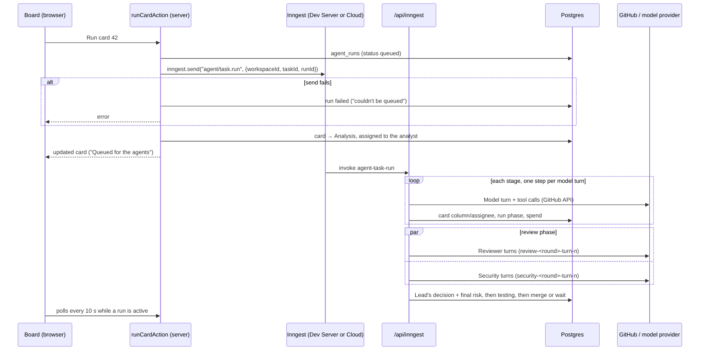

# Background jobs (Inngest)

Long-running and retryable work runs as [Inngest](https://www.inngest.com) functions, outside the request that
triggered it. Code: [`lib/inngest/`](../lib/inngest), served by [`app/api/inngest/route.ts`](../app/api/inngest/route.ts).

- [How it fits together](#how-it-fits-together)
- [Registered functions](#registered-functions)
- [agent-task-run](#agent-task-run)
- [agent-auto-pickup](#agent-auto-pickup)
- [run-sweep](#run-sweep)
- [memory-librarian](#memory-librarian)
- [Local development](#local-development)
- [Inngest Cloud (not the default)](#inngest-cloud-not-the-default)
- [Adding a function](#adding-a-function)

---

## How it fits together



- The client is created in [`lib/inngest/client.ts`](../lib/inngest/client.ts) (`id: "fastnext-app"`).
- `/api/inngest` exposes the functions with `serve()` (GET = introspection, PUT = registration, POST = execution).
- Inngest calls back into the app over HTTP: the Dev Server runs on the same computer and reaches `http://127.0.0.1:3000/api/inngest`, so nothing needs to be public.

## Registered functions

| Function id | Trigger | Source | What it does |
| --- | --- | --- | --- |
| `agent-task-run` | event `agent/task.run` | `lib/inngest/agent-run.ts` | The agent pipeline for one card (below). |
| `agent-auto-pickup` | cron `*/2 * * * *` | `lib/inngest/agent-pickup.ts` | Auto pickup: starts a run on the top never-run Todo card per workspace. |
| `preview-sweep` | cron `*/10 * * * *` | `lib/inngest/preview-sweep.ts` | Stops previews older than 2 h and removes leftovers (only with a sandbox host). |
| `run-sweep` | cron `*/5 * * * *` | `lib/inngest/run-sweep.ts` | Ends runs left behind when TechTeam stopped (below). |
| `memory-librarian` | event `memory/learn.requested` | `lib/inngest/memory-librarian.ts` | The Brain's librarian: one run per workspace at a time (below). |
| `memory-librarian-auto` | event `memory/learn.auto` (debounced) | `lib/inngest/memory-librarian.ts` | Waits until signals settle, then requests a librarian run. |

There is no function for Switch scans or remote jobs any more: nothing in TechTeam waits for a call from the internet.

## agent-task-run

Queued by **Run** (`runCardAction`) and by auto pickup, always after the `agent_runs` row exists. Event data:
`{ workspaceId, taskId, runId }` (`AgentTaskRunData`). Stage logic lives in
[`lib/agent-pipeline.ts`](../lib/agent-pipeline.ts); every step reloads what it needs from the database.

```
                                         ┌─ review (Reviewer) ──┐
analysis ──ready──▶ development ──▶ PR ──┤                      ├──▶ approval (Lead) ──approve──▶ testing ──pass──▶ merge
   │                    ▲                └─ security ───────────┘          │                         │        (or wait:
   └─needs_info─▶ Todo  │                                                  │                         │      mode × risk)
                        └──────────── request_changes / fail (≤ 2 rework rounds) ────────────────────┘
```

- **Concurrency**: one run per card (`key: "event.data.taskId"`). Runs of different cards run in parallel.
- **Retries**: 2 per step. A revoked GitHub token or missing connection throws `NonRetriableError`.
- **Cancel**: Stop sends `agent/task.cancel` (`cancelOn` matches `data.runId`); the run is already marked `cancelled`.
- **onFailure**: marks the run `failed` with the error message (`stopRun`: also closes the stage in the agent log and
  notifies the owner).
- **Stages** (`runStage` in `agent-run.ts`): one per agent (`AGENT_STAGES`: analysis, development, review, security,
  approval, testing). Review and security run in **parallel** (`Promise.all` of two `runStage` calls): Inngest runs
  their steps side by side, each still one step per model turn, with ids prefixed by the stage so they never collide.
  1. `<stage>-<round>-start` → `beginStage`: agent enabled + under budget (`checkAgentCanRun`; no budget check when the
     agent's stage takes the owner's plan on this computer), required permissions
     present (Developer: `code.write`, `pr.open`), run marked running in the stage's phase only if it's still active
     (`markStageRunning`), card moved to the phase's column and assigned (the phase's first agent only), a `task_run`
     activity row opened.
  2. `<stage>-<round>-turn-<n>` → `runStageTurn`: resolves the stage's route on its first turn (the owner's plan
     through a local CLI, or the API key; [cli-agents.md](cli-agents.md)). On the **plan route** one step is a chunk of
     up to 10 turns of Claude Code (`claude -p --resume <session>`, tools through `/api/mcp/runs/[runId]`), `<n>` jumps
     by the turns it used, and when the plan runs out the stage sleeps (`<stage>-<round>-plan-wait-<k>`,
     `step.sleepUntil` the reset) and resumes the same session in `…-turn-<n>-after-wait-<k>`, or restarts on the API
     key. On the **API route**: one model call (`lib/agent-loop.ts`) plus its tool calls
     (`lib/agent-tools.ts`). Re-checks pause/budget each turn; adds the turn's cost to the activity row and the run.
     The model is pinned on the stage's first turn. **OpenAI**: the conversation lives on OpenAI
     (`previous_response_id`); steps only carry pending tool outputs. **Anthropic** and **OpenRouter** (Chat
     Completions): the conversation is stored in `agent_run_messages` and steps only carry its length, so step output
     stays small. Three turns before the agent's **max turns** a wrap-up note follows the tool results; the last turn
     forces the finish tool (OpenAI), offers only it (OpenRouter) or adds a "finish now" system message (Claude 5.5
     models reject forced tools), and asks the Developer to submit unfinished work with what's left. A stage that still
     ends without a result goes to `<stage>-<round>-out-of-turns` → `settleOutOfTurns` (the Developer's commits and
     missing reviews continue as unfinished results; otherwise the run stops). Each turn's tool calls go
     to `agent_run_steps` (the card's agent log), and the stage's end too. If the run stopped meanwhile (the parallel
     stage failed), the turn stops too and only this stage's log is closed.
  3. **Out of credit** (OpenAI `insufficient_quota` / billing codes, Anthropic "credit balance too low", OpenRouter
     402 except its in-flight budget): with `workspaces.ai_auto_failover` on and a key for another company, the turn
     moves every agent on the broke company to the next company with a key in the workspace's fallback order (`fallbackProvider`,
     `moveAgentsToProvider`) and returns `restart`: the stage starts over on the new provider,
     **once per stage**.
     Otherwise the run stops with `failure: { kind: "out_of_credit", provider }`, which the board turns into a
     "switch and retry" notice.
- **Sandbox** ([sandbox.md](sandbox.md)): with Settings → Sandbox on, a Developer or Tester turn may call
  `run_tests` / `run_build` / `run_command`, which run inside the turn's step (up to 5 minutes each, one at a time per
  run). The run's volume is removed when the run ends (`finishRun`), whatever the outcome.
- **Between stages**: `branch-<round>` (creates `agent/<key>-<slug>` from the default branch, once per run),
  `pull-request-<round>` (opens the PR, fails if nothing was committed), the **CI gate** — `ci-<round>-start` (records
  "waiting" on the branch head; knows whether the repo has workflows in `.github/workflows/`), then
  `ci-<round>-wait-<n>` sleeps and `ci-<round>-poll-<n>` checks (10 s, then every 30 s, at most 30 polls) until every
  check finished (`classifyCi`); a failure caused by the change → `rework-after-ci-<round>`, or `ci-exhausted` after
  the last round — then `record-review-<round>` and
  `record-security-<round>` (after both parallel stages), `record-approval-<round>` (the Lead's decision raised to the
  risk floor; sets the PR's review status and risk), `record-test-<round>` (deterministic pre-checks always fail the
  verdict when they fail), `ready-to-merge` (merge mode × final risk, `mergeDecision`), then `merge-<n>` attempts
  30 s apart (automatic merges only; up to 10 minutes, then the run waits for a manual merge).
- **Merge** ([`lib/pull-requests.ts`](../lib/pull-requests.ts)): merges (squash) only when GitHub reports the PR mergeable
  and every check run / commit status passed. A conflict or failing build makes the Tester file a follow-up card in Todo
  (and a GitHub issue with the **File issues** permission); the run ends `failed` with the reason. Running the
  follow-up card continues on the same PR: the Developer merges the default branch in (`merge_default_branch`,
  [features.md](features.md#merging-the-default-branch)) and the pipeline reviews and tests it again; the merge moves
  both cards to Done.
- **Notifications** (`notify`, lib/notifications.ts; never throws, so it can't fail a step): PR ready to merge
  (manual merge, not low risk in "Automatic when low risk" — with the risk and its reasons — or auto merge timed out), merged (auto merge), merge blocked, analyst needs info, run stopped, out of
  credit, provider switched.

## agent-auto-pickup

Every 2 minutes: for each workspace with **Settings → Agents → Task pickup: Automatic** and no `queued`/`running`
run, creates a run for the top Todo card that **was never run** and sends `agent/task.run`. Skipped
for a workspace while the Analyst is paused or over budget (not on the owner's plan), or an agent's model has neither a key nor the plan on this computer. Every computer whose Inngest is up runs this cron
(they share the database); `AGENTS_AUTO_PICKUP=false` turns it off on one, and a card can't get two runs in flight
(unique index), so two computers never start the same card. Cards that were run before (failed,
needs info) wait for a human to press Run (or Answer, for a question). A never-run follow-up card the Tester filed
for a blocked merge is picked up like any other and continues on that pull request (`createCardRun`).

## run-sweep

A run is `queued` or `running` in the database while its Inngest function works; if the app or the Inngest Dev Server
stops mid-run, nothing moves it on, and the unique index (one active run per card) keeps the card's Run disabled.
Every 5 minutes `sweepStaleRuns` (`lib/run-sweep.ts`) ends a run that is `queued`/`running`, has **no `waiting`** (the
plan-limit pause), and whose latest sign of life is older than 30 minutes (`isStaleRun` in
`lib/run-recovery-config.ts`: the newest of the run's `updated_at`, its latest `agent_run_steps.created_at` and the
card's latest `agent_activity.created_at`). It never touches `needs_info`, `awaiting_merge`, `waiting`, cancelled,
failed or completed runs. The run becomes `failed` with `failure = { kind: "interrupted" }` through one conditional
update (two sweeps end it once), its open stages are closed in the agent log and activity, the card is released, and the
owner gets one notification: press Run to continue, which picks up the same branch and pull request. If Inngest later
resumes the old function, it finds the run ended and stops at its next step. A quiet stretch of up to 20 minutes (one
CLI chunk) stays under the 30-minute limit.

## memory-librarian

The Brain's librarian ([brain-plan.md](brain-plan.md#how-it-learns), `lib/librarian-run.ts`): one structured model call
that turns signals into proposals, or a repository's files into a first memory. Two functions in
`lib/inngest/memory-librarian.ts`; events in `lib/librarian-request.ts`.

```
merge / close, rejection reason, Remember this ── memory/learn.auto ──▶ memory-librarian-auto (debounce 3 min,
                                                                       at most 15) ── memory/learn.requested ──┐
Brain page: Learn now, Build first memory ───────────────────────────── memory/learn.requested ───────────────▶ memory-librarian
```

- **Automatic requests** (`requestLearning`) are sent only with memory on and **Learn automatically** on; they never
  throw into a pipeline, sync or action (4 s timeout, a warning when the Dev Server is down). `memory-librarian-auto`
  waits until a workspace has been quiet for 3 minutes (15 at most), then sends the run request.
- **`memory-librarian`**: event data `{ workspaceId, job: "learn" | "bootstrap", trigger: "auto" | "manual" }`,
  checked by `parseLibrarianRequest`; **concurrency 1 per workspace**; **no retries** (a retry would pay for the model
  again); one step. An automatic run that has nothing to do (`learnDecision`) ends without a trace. Otherwise the state
  goes to `workspaces.memory_librarian` (`running`, then `done` or `failed`). A learning run first proposes what the
  owner asked to remember for everything (no model, no key or budget), then calls the model with the other signals if
  the Lead and a key allow it; the cost goes to the Lead's `memory` activity. Each of the two steps saves its proposals
  and marks its signals used in one transaction, only when it succeeds.
- **Manual requests** mark the state `queued` first; if the event can't be sent the action reports it and the state says
  so. A queued state older than 10 minutes, or a running one older than 15 (the app stopped mid-run), reads as failed;
  nothing needs sweeping, since no signal was used.

## Local development

```bash
npm run dev            # app on :3000 + Inngest Dev Server, one terminal (concurrently)
npm run inngest:dev    # only the Dev Server: npx inngest-cli@1.53.0 dev -u http://127.0.0.1:3000/api/inngest --host 127.0.0.1 (pinned, loopback only)
npm run start:local    # production build + database + the Dev Server, one terminal (stable mode)
```

- Dev Server UI: <http://localhost:8288> — see events, runs, step output and logs; replay runs.
- No keys are needed locally. The SDK (v3) infers **Dev Mode** outside production and sends events to the Dev
  Server.
- **If the Dev Server isn't running**, sending the event fails (connection refused) and Run fails with "Is the Inngest
  Dev Server running? Start the app with `npm run dev` (it starts Inngest too)." — the run is marked failed and nothing
  is assigned. The SDK only falls back to Inngest Cloud (and a `401 Event key not found`) when Cloud keys are set.
- Cloud mode needs the keys: without `INNGEST_EVENT_KEY` or `INNGEST_SIGNING_KEY` the client is always in dev mode
  (`lib/inngest/client.ts`), also under `next start`, where the SDK would infer cloud mode from `NODE_ENV=production`.

## Inngest Cloud (not the default)

TechTeam is built to run with the local Dev Server (pinned to 1.53.0, bound to `127.0.0.1`; `TECHTEAM_INNGEST_PORT` moves
it, default 8288). Hosting TechTeam is not a supported setup. If you set `INNGEST_EVENT_KEY` and `INNGEST_SIGNING_KEY`
the client switches to Cloud Mode and `/api/inngest` verifies signatures with the signing key; Inngest Cloud then has to
reach the app, which listens on `127.0.0.1` only. `npm run doctor` lists both variables as obsolete for that reason.


## Adding a function

1. Create it in `lib/inngest/<name>.ts` with `inngest.createFunction({ id, name, retries, concurrency? }, { event }, handler)`.
   Export the event name and its data type next to it (see `AGENT_TASK_RUN` / `AgentTaskRunData`).
2. Add it to the `functions` array in `app/api/inngest/route.ts`.
3. Send events only from server code, after authorizing the user, with `inngest.send({ name, data })`.
4. Re-check ownership/existence inside the function: data can be stale by the time it runs.
5. Restart `npm run dev` (or `npm run inngest:dev` alone) if the Dev Server doesn't pick up the new function.
