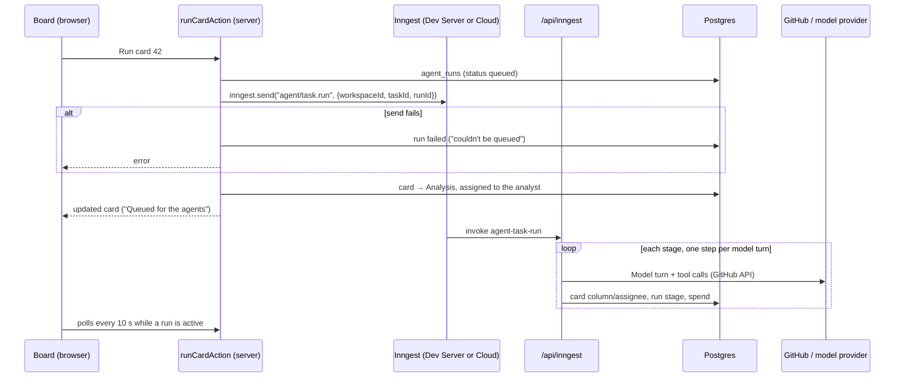

# Background jobs (Inngest)

Long-running and retryable work runs as [Inngest](https://www.inngest.com) functions, outside the request that
triggered it. Code: [`lib/inngest/`](../lib/inngest), served by [`app/api/inngest/route.ts`](../app/api/inngest/route.ts).

- [How it fits together](#how-it-fits-together)
- [Registered functions](#registered-functions)
- [agent-task-run](#agent-task-run)
- [agent-auto-pickup](#agent-auto-pickup)
- [Local development](#local-development)
- [Production](#production)
- [Adding a function](#adding-a-function)

---

## How it fits together



- The client is created in [`lib/inngest/client.ts`](../lib/inngest/client.ts) (`id: "fastnext-app"`).
- `/api/inngest` exposes the functions with `serve()` (GET = introspection, PUT = registration, POST = execution).
- Inngest calls back into the app over HTTP, so the app must be reachable from wherever Inngest runs.

## Registered functions

| Function id | Trigger | Source | What it does |
| --- | --- | --- | --- |
| `agent-task-run` | event `agent/task.run` | `lib/inngest/agent-run.ts` | The agent pipeline for one card (below). |
| `agent-auto-pickup` | cron `*/2 * * * *` | `lib/inngest/agent-pickup.ts` | Auto pickup: starts a run on the top never-run Todo card per workspace. |
| `process-task-job` | event `app/task.process` | `lib/inngest/functions.ts` | Starter-template example: two logged steps with a 2 s sleep. |
| `daily-sync-job` | cron `0 0 * * *` (daily, 00:00 UTC) | `lib/inngest/functions.ts` | Starter-template example: logs and returns `syncedRecords: 0`. |

`POST /api/inngest/trigger` is also from the starter template: it sends `app/task.process` with the request body.
It has **no authentication** — remove it or protect it before production ([security.md](security.md#known-gaps)).

## agent-task-run

Queued by **Run** (`runCardAction`) and by auto pickup, always after the `agent_runs` row exists. Event data:
`{ workspaceId, taskId, runId }` (`AgentTaskRunData`). Stage logic lives in
[`lib/agent-pipeline.ts`](../lib/agent-pipeline.ts); every step reloads what it needs from the database.

```
analysis ──ready──▶ development ──▶ PR ──▶ review ──approve──▶ testing ──pass──▶ merge
   │                    ▲                     │                    │
   └─needs_info─▶ Todo  └──── request_changes / fail (≤ 2 rework rounds) ┘
```

- **Concurrency**: one run per card (`key: "event.data.taskId"`). Runs of different cards run in parallel.
- **Retries**: 2 per step. A revoked GitHub token or missing connection throws `NonRetriableError`.
- **Cancel**: Stop sends `agent/task.cancel` (`cancelOn` matches `data.runId`); the run is already marked `cancelled`.
- **onFailure**: marks the run `failed` with the error message.
- **Stages** (`runStage` in `agent-run.ts`):
  1. `<stage>-<round>-start` → `beginStage`: agent enabled + under budget (`checkAgentCanRun`), required skills
     present (Developer: `code.write`, `pr.open`), card moved to the stage's column and assigned, a `task_run`
     activity row opened.
  2. `<stage>-<round>-turn-<n>` → `runStageTurn`: one model call (`lib/agent-loop.ts`) plus its tool calls
     (`lib/agent-tools.ts`). Re-checks pause/budget each turn; adds the turn's cost to the activity row and the run.
     The model is pinned on the stage's first turn. **OpenAI**: the conversation lives on OpenAI
     (`previous_response_id`); steps only carry pending tool outputs. **Anthropic**: the conversation is stored in
     `agent_run_messages` and steps only carry its length, so step output stays small. The last allowed turn (the
     agent's **max turns**) forces the finish tool (OpenAI) or adds a "finish now" system message (Claude 5.5 models
     reject forced tools), so a stage ends with a structured result or "ran out of turns".
- **Between stages**: `branch-<round>` (creates `agent/<key>-<slug>` from the default branch, once per run),
  `pull-request-<round>` (opens the PR, fails if nothing was committed), `record-review-<round>`, `record-test-<round>`
  (deterministic pre-checks always fail the verdict when they fail), `ready-to-merge`, then `merge-<n>` attempts
  30 s apart (auto-merge only; up to 10 minutes, then the run waits for a manual merge).
- **Merge** ([`lib/pull-requests.ts`](../lib/pull-requests.ts)): merges (squash) only when GitHub reports the PR mergeable
  and every check run / commit status passed. A conflict or failing build makes the Tester file a follow-up card in Todo
  (and a GitHub issue with the **File issues** skill); the run ends `failed` with the reason.

## agent-auto-pickup

Every 2 minutes: for each workspace with **Settings → Agents → Task pickup: Automatic** and no `queued`/`running`
run, creates a run for the top Todo card that **was never run** and sends `agent/task.run`. Skipped entirely without
a provider (`OPENAI_API_KEY`, `ANTHROPIC_API_KEY`, or `AGENTS_SIMULATED=true`), and per workspace while the Analyst is paused or over budget, or an agent's model has no provider key. Cards that were run before (failed,
needs info) wait for a human to press Run.

## Local development

```bash
npm run dev            # app on :3000
npm run inngest:dev    # npx inngest-cli@latest dev -u http://localhost:3000/api/inngest
```

- Dev Server UI: <http://localhost:8288> — see events, runs, step output and logs; replay runs.
- No keys are needed locally. The SDK (v3) infers **Dev Mode** outside production and sends events to the Dev
  Server.
- **If the Dev Server isn't running**, the SDK falls back to Inngest Cloud with the placeholder `INNGEST_EVENT_KEY`
  and gets `401 Event key not found`. Run then fails with "Is the Inngest Dev Server running? Start it with
  `npm run inngest:dev`." — the run is marked failed and nothing is assigned.
- Force a mode with `INNGEST_DEV=1` (dev) or `INNGEST_DEV=0` (cloud).

## Production

1. Create an app in the Inngest dashboard and copy the **Event key** and **Signing key** into `INNGEST_EVENT_KEY`
   and `INNGEST_SIGNING_KEY`.
2. Deploy. In Cloud Mode `/api/inngest` verifies request signatures with the signing key.
3. Sync the app in the Inngest dashboard with `https://<your-domain>/api/inngest` (or use the Vercel integration).
4. Remove the starter-template examples (`functions.ts`, `/api/inngest/trigger`) if you don't need them.

## Adding a function

1. Create it in `lib/inngest/<name>.ts` with `inngest.createFunction({ id, name, retries, concurrency? }, { event }, handler)`.
   Export the event name and its data type next to it (see `AGENT_TASK_RUN` / `AgentTaskRunData`).
2. Add it to the `functions` array in `app/api/inngest/route.ts`.
3. Send events only from server code, after authorizing the user, with `inngest.send({ name, data })`.
4. Re-check ownership/existence inside the function: data can be stale by the time it runs.
5. Restart `npm run inngest:dev` if the Dev Server doesn't pick up the new function.
