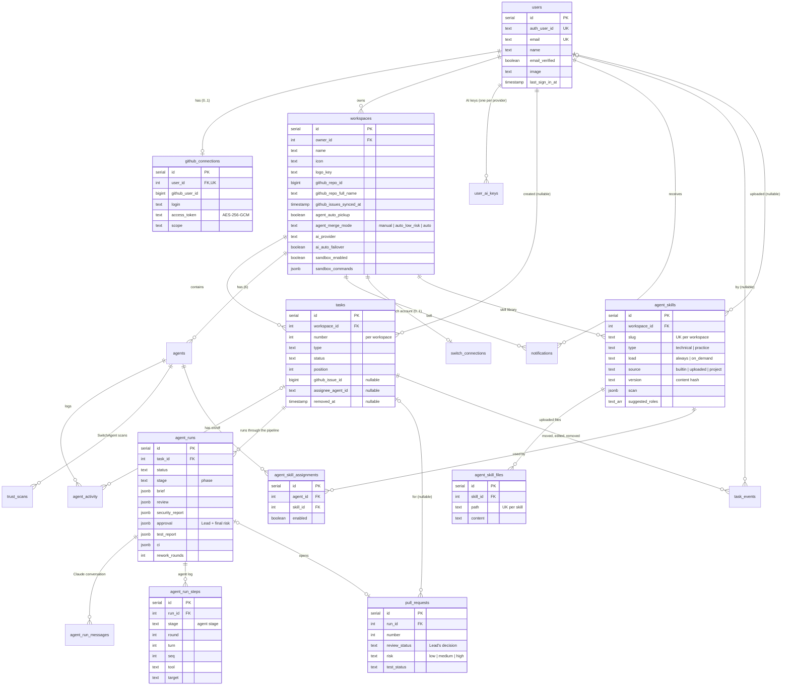

# Data model

All app data lives in PostgreSQL, in the `public` schema, defined in [`db/schema.ts`](../db/schema.ts) with Drizzle.
The hosted auth service keeps identities elsewhere (its own `auth` schema); the app only mirrors what it needs.

- [Diagram](#diagram)
- [users](#users)
- [github_connections](#github_connections)
- [workspaces](#workspaces)
- [user_ai_keys](#user_ai_keys)
- [ai_provider_keys](#ai_provider_keys)
- [tasks](#tasks)
- [agents](#agents)
- [agent_skills, agent_skill_files, agent_skill_assignments](#agent_skills)
- [agent_activity](#agent_activity)
- [agent_runs](#agent_runs)
- [agent_run_messages](#agent_run_messages)
- [pull_requests](#pull_requests)
- [Value vocabularies](#value-vocabularies)
- [Behaviors worth knowing](#behaviors-worth-knowing)
- [Schema changes](#schema-changes)

---

## Diagram

Every foreign key to `users` / `workspaces` is `ON DELETE CASCADE`, as are `agent_runs.task_id` and the skill tables'
foreign keys to `agent_skills` / `agents`. `SET NULL`: `agent_skills.created_by_id`, `tasks.created_by_id`, `agent_activity.task_id`, `agent_runs.created_by_id`, `pull_requests.task_id` / `run_id` /
`follow_up_task_id`.

## users

Mirror of the hosted auth user. Created on first sign-in, refreshed on every sign-in (`lib/user-sync.ts`).

| Column | Type | Null | Default | Notes |
| --- | --- | --- | --- | --- |
| `id` | serial | no | | Primary key. What every other table references. |
| `auth_user_id` | text | no | | Better Auth `user.id`. **Unique.** Used to find the row from a session. |
| `name` | text | yes | | Display name from the auth service. |
| `email` | text | no | | **Unique.** |
| `email_verified` | boolean | no | `false` | |
| `image` | text | yes | | Avatar URL (e.g. from GitHub/Google). |
| `created_at` | timestamp | no | `now()` | "Member since". |
| `updated_at` | timestamp | no | `now()` | |
| `last_sign_in_at` | timestamp | no | `now()` | Updated on each sign-in. |

## github_connections

A user's linked GitHub account, used to read repositories and issues. **One per user** (`user_id` is unique).
Independent from "Sign in with GitHub" — see [github-integration.md](github-integration.md#why-a-separate-oauth-app).

| Column | Type | Null | Notes |
| --- | --- | --- | --- |
| `id` | serial | no | Primary key. |
| `user_id` | integer | no | → `users.id`, cascade. **Unique.** |
| `github_user_id` | bigint | no | GitHub's numeric user id. |
| `login` | text | no | GitHub username, shown as "Connected as @login". |
| `avatar_url` | text | yes | |
| `access_token` | text | no | **Encrypted** with AES-256-GCM (`lib/crypto.ts`), format `v1.<iv>.<tag>.<ciphertext>`. Only `getGithubToken()` decrypts it; never send it to the client. |
| `scope` | text | yes | Scopes GitHub granted (expected `repo,read:user`). |
| `created_at`, `updated_at` | timestamp | no | `updated_at` changes on reconnect. |

Reconnecting overwrites the row (upsert on `user_id`). "Disconnect" deletes it.

## workspaces

A workspace is bound to **exactly one** GitHub repository, chosen at creation. Owned by one user.

| Column | Type | Null | Notes |
| --- | --- | --- | --- |
| `id` | serial | no | Primary key. Appears in URLs (`/dashboard/<id>`). |
| `owner_id` | integer | no | → `users.id`, cascade. Indexed (`workspaces_owner_id_idx`). |
| `name` | text | no | 1–60 characters (validated in `createWorkspace`). Also drives the task key prefix. |
| `icon` | text | no | Key from `lib/workspace-icons.ts` (16 icons), used when there's no logo. |
| `logo_key` | text | yes | S3 object key of an uploaded logo, e.g. `workspace-logos/1/<uuid>.png`. |
| `github_repo_id` | bigint | no | GitHub's numeric repository id. |
| `github_repo_full_name` | text | no | `owner/name`. Used for every GitHub API call about this workspace. |
| `github_repo_url` | text | no | `https://github.com/owner/name`. |
| `github_default_branch` | text | no | Snapshot at link time. |
| `github_repo_private` | boolean | no | Snapshot at link time. |
| `github_issues_synced_at` | timestamp | yes | Last successful issue sync, **minus 60 s** of overlap; passed to GitHub as `since`. `null` = never synced (the next sync imports all open issues). |
| `agent_auto_pickup` | boolean | no | Default `false`. Settings → Agents: the analyst takes never-run Todo cards on its own. |
| `agent_merge_mode` | text | no | Default `manual`. Settings → Agents → Merging (`MERGE_MODES`): `manual`, `auto_low_risk` (merge on their own only when the Lead's final risk is low) or `auto` (merge once approval, tests and CI pass). Backfilled from v0.1's `agent_auto_merge` (true → `auto`) by migration 0005; that column was dropped in 0007. Unknown values read as `manual`. |
| `ai_provider` | text | no | Default `openai`. **No longer read** (2026-11-19): each agent's model sets its company. Kept while the dev database is shared with older branches; a later migration drops it. |
| `ai_auto_failover` | boolean | no | Default `false`. Settings → AI providers: when a company runs out of credit mid-run and the other has a key, move the agents on it there and restart the stage. |
| `sandbox_enabled` | boolean | no | Default `false`. Settings → Sandbox: agents with `tests.run` get the sandbox tools (migration 0009). |
| `sandbox_commands` | jsonb | yes | `{ install, test, build }` (each a command or null), saved with the switch, prefilled from `package.json`. See [sandbox.md](sandbox.md). |
| `created_at`, `updated_at` | timestamp | no | |

The repository metadata is captured once. If the repo is renamed or its default branch changes on GitHub, these
columns aren't updated (yet).

## user_ai_keys

A user's API key per AI provider (Settings → Your account → AI keys), used by every workspace they own. It wins over a
workspace's own key; the server's environment key comes last (`keyInUse` in `lib/ai-keys.ts`). Migration 0010 moved
every workspace key here (the newest per owner and provider) and deleted the workspace copies.

| Column | Type | Null | Notes |
| --- | --- | --- | --- |
| `id` | serial | no | Primary key. |
| `user_id` | integer | no | → `users.id`, cascade. **Unique with `provider`.** |
| `provider` | text | no | `openai` or `anthropic`. |
| `api_key` | text | no | **Encrypted** with AES-256-GCM (`lib/crypto.ts`). Only `getAIKeys()` decrypts it; never send it to the client. |
| `hint` | text | no | Masked key for display, e.g. `sk-ant-••••a1B2`. |
| `updated_at` | timestamp | no | |

## ai_provider_keys

A workspace's own API key per AI provider (Settings → This workspace → AI provider), optional: used only for a provider
the owner's account has no key for. Separate from `workspaces` so a workspace row never carries a secret.

| Column | Type | Null | Notes |
| --- | --- | --- | --- |
| `id` | serial | no | Primary key. |
| `workspace_id` | integer | no | → `workspaces.id`, cascade. **Unique with `provider`.** |
| `provider` | text | no | `openai` or `anthropic`. |
| `api_key` | text | no | **Encrypted** with AES-256-GCM (`lib/crypto.ts`). Only `getAIKeys()` decrypts it; never send it to the client. |
| `hint` | text | no | Masked key for display, e.g. `sk-ant-••••a1B2`. |
| `updated_at` | timestamp | no | |

## tasks

A card on a workspace's Kanban board. Created in the app, or imported from a GitHub issue.

| Column | Type | Null | Default | Notes |
| --- | --- | --- | --- | --- |
| `id` | serial | no | | Primary key. Used as the card id in the UI (as a string). |
| `workspace_id` | integer | no | | → `workspaces.id`, cascade. |
| `number` | integer | no | | Per-workspace sequence shown in the key, e.g. `ACM-142`. Allocated as `max(number) + 1` under a workspace row lock. **Unique with `workspace_id`.** |
| `type` | text | no | | `feature` \| `bug` \| `issue`. |
| `title` | text | no | | ≤ 120 characters when written by the app; GitHub titles are stored as-is. |
| `description` | text | no | `''` | ≤ 5000 characters (GitHub bodies are truncated to that). |
| `priority` | text | no | | `urgent` \| `high` \| `medium` \| `low`. |
| `status` | text | no | | Column id: `todo` \| `in_development` \| `in_review` \| `testing` \| `done`. |
| `position` | integer | no | | Sort key within the column, ascending. **Not contiguous**: new cards take `min(position) - 1` (top, can go negative); a drag-and-drop rewrites the touched columns as `0..n-1`. |
| `labels` | text[] | no | `'{}'` | Lowercase, trimmed, unique, ≤ 5 labels of ≤ 30 characters. |
| `due_date` | date | yes | | Calendar date, handled as a `yyyy-MM-dd` string. |
| `created_by_id` | integer | yes | | → `users.id`, `SET NULL`. `null` for GitHub imports. |
| `github_issue_id` | bigint | yes | | GitHub's global issue id. **Unique with `workspace_id`** (NULLs don't conflict, so app cards are unaffected). Non-null ⇒ the card mirrors a GitHub issue. |
| `github_issue_number` | integer | yes | | The `#123` shown on the card. |
| `github_issue_url` | text | yes | | Link to the issue. |
| `github_issue_state` | text | yes | | `open` \| `closed`, as last seen on GitHub. |
| `github_updated_at` | timestamp | yes | | The issue's `updated_at` at the last sync; a sync only rewrites the card when GitHub's value is newer. |
| `assignee_agent_id` | text | yes | | Agent role key (`agents.key`, set by **Run** — currently always `analyst`). |
| `removed_at` | timestamp | yes | | Set by **Remove task**. Removed rows are hidden everywhere but kept (see below). |
| `created_at`, `updated_at` | timestamp | no | `now()` | |

Indexes and constraints:

| Name | Columns | Purpose |
| --- | --- | --- |
| `tasks_workspace_number_unique` | `(workspace_id, number)` | Keys are never duplicated. |
| `tasks_workspace_github_issue_unique` | `(workspace_id, github_issue_id)` | One card per GitHub issue, even with concurrent syncs. |
| `tasks_workspace_status_position_idx` | `(workspace_id, status, position)` | Loading and ordering columns. |

## agents

One row per agent role per workspace. The six roles (`analyst`, `developer`, `reviewer`, `security`, `lead`,
`tester`) are created on first use by `ensureDefaultAgents()` with the defaults in
[`lib/agent-config.ts`](../lib/agent-config.ts); roles added later are created in existing workspaces the same way.

| Column | Type | Null | Default | Notes |
| --- | --- | --- | --- | --- |
| `id` | serial | no | | Primary key. |
| `workspace_id` | integer | no | | → `workspaces.id`, cascade. |
| `key` | text | no | | Role key. **Unique with `workspace_id`.** Also what `tasks.assignee_agent_id` stores. |
| `description` | text | no | | One sentence, ≤ 280 chars. |
| `instructions` | text | no | | The agent's operating instructions (system prompt), 50–8,000 chars. |
| `model` | text | no | | Model id from `AGENT_MODELS`, on either company: its provider is the agent's company (AI Team → Configure). |
| `provider_models` | jsonb | no | `{}` | The agent's model per provider (`{ openai, anthropic }`), so a provider switch and back restores it. |
| `skills` | text[] | no | `{}` | **Permission** ids from `PERMISSIONS` (`permissions` in Drizzle). Kept its v0.1 name; "skills" now means the knowledge packs in `agent_skills`. |
| `monthly_budget_cents` | integer | no | | $1–$10,000. |
| `max_turns` | integer | yes | | Model turns per pipeline stage (3–100). `null` = role default (`AGENT_ROLES[key].defaults.maxTurns`: analyst 12, developer 40, reviewer 15, security 15, lead 8, tester 12). |
| `enabled` | boolean | no | `true` | Paused agents can't be Run; a running stage stops at its next turn. |
| `trust_score` | integer | yes | | Latest Trust Score (0–100), duplicated from the report for queries. |
| `trust_report` | jsonb | yes | | `TrustReport` (`lib/agent-trust.ts`): findings, checks, mode (`rules` \| `ai` \| `switch`), model, time; Switch reports add `evaluation` and `coverage`. |
| `trust_scanned_at` | timestamp | yes | | |
| `switch_agent_id` | text | yes | | Agent fingerprint in Switch Trust (`agn_…`), set on its first SwitchAgent scan; cleared when the account changes. |
| `created_at`, `updated_at` | timestamp | no | `now()` | |

## agent_skills

The workspace's skill library (Settings → Agent skills): knowledge packs in the Agent Skills format that agents search
and read. Built-ins are upserted by `ensureBuiltinSkills()` (`lib/agent-skills.ts`, called from `ensureDefaultAgents`)
from `agent-skills/catalog.json`, and their files are read from disk; uploaded skills keep their files in
`agent_skill_files`. A blocked upload is never stored.

| Column | Type | Null | Default | Notes |
| --- | --- | --- | --- | --- |
| `id` | serial | no | | Primary key. |
| `workspace_id` | integer | no | | → `workspaces.id`, cascade. |
| `slug` | text | no | | Frontmatter `name` (built-ins: their slug). **Unique with `workspace_id`.** What agents pass to the skill tools. Uploads can't take a built-in's name. |
| `name`, `description` | text | no | | From SKILL.md frontmatter (≤ 64 / ≤ 1024 chars). |
| `type` | text | no | | `technical` \| `practice`. |
| `load` | text | no | | `always` (SKILL.md body ≤ 8 KB in every prompt) \| `on_demand`. |
| `source` | text | no | | `builtin` \| `uploaded` \| `project` (reserved for skills from the linked repository). |
| `origin` | text | no | | `GoogleChrome/modern-web-guidance@64a6d70` or `Uploaded by <name>`. |
| `license` | text | yes | | SPDX id or the frontmatter `license`. |
| `version` | text | no | | Content hash (12 hex chars of sha256 over the sorted files); changes with every new version. |
| `file_count`, `total_bytes` | integer | no | | Text files kept and their UTF-8 size. |
| `scan` | jsonb | yes | | `SkillScan` (`lib/agent-skills-config.ts`): `status` (`passed` \| `warned`), findings (rules and AI), `reviewedBy` (`builtin` \| `rules` \| `ai`), model, time. |
| `suggested_roles` | text[] | no | `{}` | Agent keys it fits: built-ins' default roles, or the upload's metadata / AI proposal. |
| `requires_permissions` | text[] | no | `{}` | Permission ids from `techteam-requires`; the configure dialog warns when an agent lacks one. |
| `created_by_id` | integer | yes | | → `users.id`, set null. |
| `created_at`, `updated_at` | timestamp | no | `now()` | |

**`agent_skill_files`** — files of uploaded skills: `skill_id` (→ `agent_skills.id`, cascade), `path` (relative,
validated; **unique with `skill_id`**), `content` (text), `title` and `summary` (what `search_skill` matches), `size`.

**`agent_skill_assignments`** — which agent uses which skill: `agent_id` (→ `agents.id`, cascade), `skill_id`
(→ `agent_skills.id`, cascade, indexed), `enabled`, timestamps; **unique (`agent_id`, `skill_id`)**. Switching a skill
off keeps the row with `enabled = false`, so `ensureBuiltinSkills` (which only inserts missing rows for a built-in's
default roles) never turns it back on.

## task_events

What people did to cards, for the Activity page (`lib/task-events.ts`). Creating a card needs no row
(`tasks.created_by_id` says it); reordering within a column isn't logged.

| Column | Type | Null | Default | Notes |
| --- | --- | --- | --- | --- |
| `id` | serial | no | | Primary key. |
| `workspace_id` | integer | no | | → `workspaces.id`, cascade. Index with `created_at`. |
| `task_id` | integer | no | | → `tasks.id`, cascade (cards are soft-deleted, so rows stay). |
| `user_id` | integer | yes | | → `users.id`, set null. |
| `kind` | text | no | | `task_moved`, `task_edited`, `task_removed`. |
| `title` | text | no | | E.g. "Moved AJU-5 to In Review". |
| `detail` | text | yes | | The card title, plus the changed fields for edits. |
| `created_at` | timestamp | no | `now()` | |

## switch_connections

A workspace's Switch Trust account (Settings → Switch Trust). See [switch-trust.md](switch-trust.md).

| Column | Type | Null | Default | Notes |
| --- | --- | --- | --- | --- |
| `id` | serial | no | | Primary key. |
| `workspace_id` | integer | no | | → `workspaces.id`, cascade. **Unique.** |
| `api_key` | text | yes | | AES-256-GCM ciphertext. `null` = the server's `SWITCH_AGENT_AI_API_KEY`. Never sent to the client. |
| `hint` | text | yes | | Masked key for display. |
| `auth_scheme` | text | no | | `ApiKey` or `Bearer`, whichever the instance accepted. |
| `instance_url` | text | no | | API base, e.g. `https://api.switchagents.ai/api/v1`. |
| `tenant_id`, `switch_workspace_id` | text | no | | Scope of every Switch call. |
| `evaluation_id`, `evaluation_name` | text | yes | | The one evaluation every agent runs, picked on the first scan. |
| `weekly_scans` | boolean | no | `true` | Settings → Switch Trust → Scan every week (`switch-weekly-scans` cron). |
| `created_at`, `updated_at` | timestamp | no | `now()` | |

## trust_scans

One SwitchAgent scan of one agent, advanced in the background by Cloudhike jobs.

| Column | Type | Null | Default | Notes |
| --- | --- | --- | --- | --- |
| `id` | serial | no | | Primary key. |
| `workspace_id` | integer | no | | → `workspaces.id`, cascade. |
| `agent_id` | integer | no | | → `agents.id`, cascade. Index with `created_at`. |
| `trigger` | text | no | | `connected` (account connected or a provider key saved), `manual` (SwitchAgent Scan) or `scheduled` (weekly). |
| `status` | text | no | | `queued`, `running`, `succeeded`, `failed`. |
| `switch_run_id` | text | yes | | Evaluation run in Switch. |
| `job_id` | text | yes | | Latest Cloudhike job run. |
| `token_hash` | text | yes | | sha256 of the current job's token; cleared when the scan ends. |
| `error` | text | yes | | Why it failed, for the owner. |
| `cost_micros` | integer | no | `0` | Model spend answering Switch's tests; logged with the result. |
| `created_by_id` | integer | yes | | → `users.id`, set null. |
| `created_at`, `updated_at`, `finished_at` | timestamp | | | |

## agent_activity

Event log shown in the activity drawer, and the spend ledger: monthly spending is `sum(cost_micros)` for the calendar
month in UTC.

| Column | Type | Null | Default | Notes |
| --- | --- | --- | --- | --- |
| `id` | serial | no | | Primary key. |
| `workspace_id` | integer | no | | → `workspaces.id`, cascade. |
| `agent_id` | integer | no | | → `agents.id`, cascade. |
| `kind` | text | no | | `AGENT_ACTIVITY_KINDS`: `joined`, `configured`, `paused`, `resumed`, `generated`, `scan`, `task_assigned`, `task_run` (one pipeline stage; its cost grows each turn), `pull_request` (opened / merged), `issue_filed` (merge follow-up). |
| `title`, `detail` | text | no / yes | | Display text, written at event time. |
| `cost_micros` | integer | no | `0` | Model spend in micro-dollars (1e-6 USD), from the provider's reported token usage. |
| `task_id` | integer | yes | | → `tasks.id`, `SET NULL`. |
| `created_at` | timestamp | no | `now()` | Indexed with `agent_id` and with `workspace_id`. |

## agent_runs

One pass of a card through the agent pipeline ([background-jobs.md](background-jobs.md#agent-task-run)). The board
shows each card's latest run.

| Column | Type | Null | Default | Notes |
| --- | --- | --- | --- | --- |
| `id` | serial | no | | Primary key; also the Inngest cancel key (`agent/task.cancel` matches `data.runId`). |
| `workspace_id` | integer | no | | → `workspaces.id`, cascade. Indexed with `status`. |
| `task_id` | integer | no | | → `tasks.id`, cascade. Indexed with `started_at`. |
| `trigger` | text | no | | `manual` (Run) or `auto` (auto pickup). |
| `status` | text | no | | `RUN_STATUSES`: `queued`, `running`, `awaiting_merge`, `completed`, `needs_info`, `failed`, `cancelled`. |
| `stage` | text | yes | | The current phase, `RUN_STAGES`: `analysis`, `development`, `review` (Reviewer and Security in parallel), `approval` (Lead), `testing`, `merge`. |
| `branch` | text | yes | | `agent/<key>-<slug>` (suffix `-r<id>` if a previous run left that name). |
| `brief` | jsonb | yes | | `AnalystBrief`: decision, summary, acceptance criteria, plan, relevant files, notes, question. |
| `review` | jsonb | yes | | `ReviewReport` (Reviewer): verdict, summary, findings. |
| `security_report` | jsonb | yes | | `SecurityReport` (Security, same round as `review`): verdict `pass`/`issues`, summary, findings with severity (critical…low), category (secrets, injection, permissions, dependencies, other), path, detail. |
| `approval` | jsonb | yes | | `LeadDecision`: decision (`approve` / `request_changes`), final risk (`low`/`medium`/`high`, already raised to `riskFloor`), risk reasons, summary, required changes (source, path, detail). |
| `test_report` | jsonb | yes | | `TestReport`: verdict, summary, checks (failed pre-checks included). Cleared when the Lead requests changes (that round's tests never ran). |
| `ci` | jsonb | yes | | `CiResult[]`, one per development round: state (waiting, passed, failed, none, timed_out), commit, number of checks, failing checks (name, conclusion, link) and those failing on the default branch too. Never logs. |
| `rework_rounds` | integer | no | `0` | Development rounds after the first (max `MAX_REWORK_ROUNDS` = 2). |
| `error` | text | yes | | Why it stopped, or the analyst's question (`needs_info`). Shown on the card. |
| `answer` | text | yes | | The owner's answer to the analyst's question (`needs_info` runs, `answerCardAction`). Later runs of the card read it into their prompts. |
| `failure` | jsonb | yes | | `RunFailure`, the stop as data the UI can act on: `{ kind: "out_of_credit", provider }` (board notice, switch and retry). Cleared when a stage starts. |
| `cost_micros` | integer | no | `0` | Model spend of the whole run. Per-agent spend stays in `agent_activity`. |
| `created_by_id` | integer | yes | | → `users.id`, `SET NULL`. Null for auto pickup. |
| `started_at`, `updated_at`, `finished_at` | timestamp | no / no / yes | `now()` | `finished_at` is set on terminal statuses (not `awaiting_merge`). |

## agent_run_messages

Conversation history of an agent stage on Anthropic or OpenRouter (stateless APIs). OpenAI keeps its conversation
server-side and stores nothing here. Kept out of Inngest step output, which would otherwise carry the whole growing
history on every turn.

| Column | Type | Null | Default | Notes |
| --- | --- | --- | --- | --- |
| `id` | serial | no | | Primary key. |
| `run_id` | integer | no | | → `agent_runs.id`, cascade. |
| `conversation` | text | no | | `<agent stage>:<rework round>`, e.g. `development:1`, `security:0`. |
| `seq` | integer | no | | Position in the conversation. **Unique with `run_id`, `conversation`**: a retried turn overwrites its own rows. |
| `message` | jsonb | no | | The provider's message param, verbatim: Anthropic (thinking blocks must go back unchanged) or Chat Completions (OpenRouter; tool calls and `reasoning_details` go back unchanged). |
| `created_at` | timestamp | no | `now()` | |

## agent_run_steps

The card's **agent log**: what each stage did. One row per tool call, plus one `result` (or `stopped`) row when a
stage ends. Read by `getTaskRunLog` (lib/agent-runs.ts) for the board's "View agent log" panel.

| Column | Type | Null | Default | Notes |
| --- | --- | --- | --- | --- |
| `id` | serial | no | | Primary key. |
| `run_id` | integer | no | | → `agent_runs.id`, cascade. |
| `stage`, `round`, `turn`, `seq` | text / int / int / int | no | | Position. `stage` is the agent stage (`AGENT_STAGES`: `analysis`, `development`, `review`, `security`, `approval`, `testing`), so the parallel Reviewer and Security never share a position. **Unique together with `run_id`**: a retried Inngest step rewrites its rows. The stage's end row uses `seq` 1000. |
| `tool` | text | no | | Tool name (`read_file`, `write_file` …), or `result` / `stopped`. |
| `target` | text | yes | | The path, prefix or query the call was about. |
| `ok` | boolean | no | | False when the tool answered with an error, or the stage stopped. |
| `summary` | text | yes | | First line of the tool's answer (≤ 200 chars) for writes and errors; null for reads (never file contents). The stage's result or stop reason on end rows. |
| `model` | text | yes | | The model that ran the turn. |
| `cost_micros` | integer | no | `0` | Only on end rows: the stage's model spend. |
| `created_at` | timestamp | no | `now()` | |

## notifications

The header bell. One row per event for the workspace's owner ([lib/notifications.ts](../lib/notifications.ts)).

| Column | Type | Null | Default | Notes |
| --- | --- | --- | --- | --- |
| `id` | serial | no | | Primary key. |
| `workspace_id` | integer | no | | → `workspaces.id`, cascade. |
| `user_id` | integer | no | | → `users.id`, cascade. Indexed with `workspace_id`, `created_at`. |
| `kind` | text | no | | `NOTIFICATION_KINDS`: `pr_ready`, `merged`, `merge_blocked`, `needs_info`, `run_failed`, `out_of_credit`, `provider_switched`. |
| `title`, `body` | text | no / yes | | |
| `href` | text | yes | | In-app path, e.g. `/dashboard/1/board?log=42` (opens that card's agent log). |
| `task_id` | integer | yes | | → `tasks.id`, `SET NULL`. |
| `read_at` | timestamp | yes | | Null = unread. |
| `created_at` | timestamp | no | `now()` | |

## pull_requests

Pull requests the Developer opened. One per run; rework rounds push to the same PR.

| Column | Type | Null | Default | Notes |
| --- | --- | --- | --- | --- |
| `id` | serial | no | | Primary key. |
| `workspace_id` | integer | no | | → `workspaces.id`, cascade. **Unique with `number`.** |
| `task_id`, `run_id` | integer | yes | | → `tasks.id` / `agent_runs.id`, `SET NULL`. |
| `number`, `github_id`, `url` | int / bigint / text | no | | The GitHub PR. |
| `title`, `head_branch`, `base_branch` | text | no | | |
| `state` | text | no | | `open`, `merged`, `closed`. Refreshed from GitHub on the Pull Requests page. |
| `review_status` | text | no | `pending` | The Lead's decision: `pending`, `approved`, `changes_requested`. Reset to `pending` on rework. |
| `risk` | text | yes | | The Lead's final risk: `low`, `medium`, `high`. Null until approval; reset on rework. |
| `test_status` | text | no | `pending` | `pending`, `passed`, `failed`. |
| `merge_error` | text | yes | | Why the last merge attempt was blocked; cleared on merge. |
| `follow_up_task_id` | integer | yes | | → `tasks.id`, `SET NULL`. The Tester's card for a blocked merge (one per PR). |
| `merged_at`, `created_at`, `updated_at` | timestamp | yes / no / no | | |

## Value vocabularies

`type`, `priority` and `status` are plain `text` columns, not Postgres enums; the allowed values live in
[`lib/board-config.ts`](../lib/board-config.ts) (`ISSUE_TYPES`, `ISSUE_PRIORITIES`, `BOARD_COLUMNS`) and are
enforced by the server-side validators in `lib/board.ts` (`parseCardInput`, `parseBoardInput`). If a row ever holds
an unknown `status` (e.g. after renaming a column), `getBoardData` shows it in **Todo** rather than hiding it.

Agent ids (`assignee_agent_id`, `agents.key`) are the role keys in `AGENT_KEYS`
([`lib/agent-config.ts`](../lib/agent-config.ts)): `analyst`, `developer`, `reviewer`, `security`, `lead`, `tester`. An unknown id renders
as unassigned. `model` and `skills` (permissions) are validated against `AGENT_MODELS` / `PERMISSIONS` by `parseAgentConfigInput`.
Skill `type`, `load` and `source` values live in [`lib/agent-skills-config.ts`](../lib/agent-skills-config.ts).

## Behaviors worth knowing

**Task keys.** The key is computed, not stored: `taskKeyPrefix(workspace.name)` + `-` + `number`. The prefix is the
first three letters of the workspace name, uppercased (`Acme Platform` → `ACM`, a name without letters → `TSK`).
Renaming a workspace therefore changes every key's prefix; the numbers stay.

**Soft delete.** "Remove task" sets `removed_at`; rows are never deleted by the app, because:
- keys must never be reused (`number` stays taken), and
- a removed GitHub issue must not be imported again by the next sync (the row with its `github_issue_id` remains).

Every board query goes through `onBoard()` in `lib/board.ts` (`workspace_id = ? AND removed_at IS NULL`), so removed
cards can't be read, edited, moved, assigned or run.

**Ownership of fields on GitHub cards.** GitHub owns `title`, `description`, `labels`, `github_*`; the board owns
`status`, `position`, `type`, `priority`, `due_date`, `assignee_agent_id`. Details in
[github-integration.md](github-integration.md#ownership-rules).

**Locking.** Creating a card and running a GitHub sync both start with
`SELECT … FROM workspaces WHERE id = ? FOR UPDATE` inside a transaction, which serializes numbering and syncs per
workspace.

**Deleting a user or workspace** cascades to everything below it (connections, workspaces, tasks, agents, agent activity, runs, pull requests). There's no UI
for either yet.

## Schema changes

The project uses **Drizzle migrations** (SQL files in `drizzle/`, committed):

1. Edit `db/schema.ts`.
2. `npm run db:generate` writes the next migration (`drizzle/NNNN_<name>.sql`) from the difference between the schema
   and the last snapshot (`drizzle/meta/`). Read the SQL. Name it with `npx drizzle-kit generate --name <what>`.
3. `npm run db:migrate` applies pending migrations (recorded in `drizzle.__drizzle_migrations`).
4. Commit the schema, the migration and the code that uses it together.

Things to know:

- `0000_baseline.sql` is the whole schema as of November 2026. Databases created earlier with `db:push` already have
  it: run `npm run db:baseline` once (scripts/db-baseline.mjs marks migrations as applied without running them).
- Only the `public` schema is managed (`schemaFilter` in `drizzle.config.ts`); never the hosted auth service's `auth`
  schema. `pg_stat_*` tables are ignored.
- Renames are ambiguous to drizzle-kit (rename vs. drop + add): `generate` asks in an interactive terminal. Answer
  carefully; a wrong "drop + add" loses the column's data.
- Adding a unique constraint to a table with rows can fail on duplicates: clean the rows first, in the same migration
  (edit the generated SQL) or before it.
- `npm run db:push` still exists for throwaway local databases while prototyping. Don't use it on shared or
  production databases: it leaves no migration behind.
