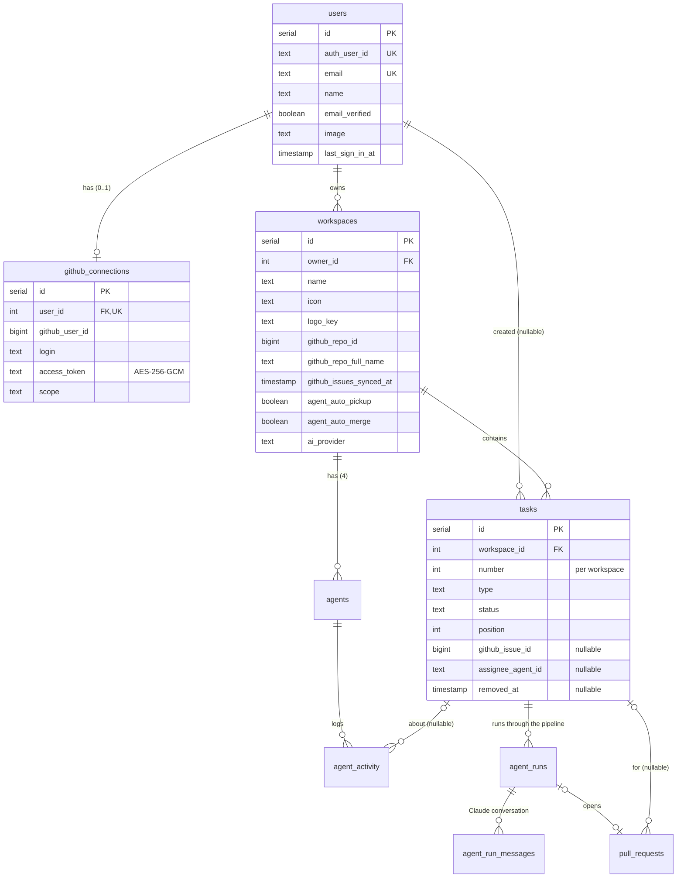

# Data model

All app data lives in PostgreSQL, in the `public` schema, defined in [`db/schema.ts`](../db/schema.ts) with Drizzle.
The hosted auth service keeps identities elsewhere (its own `auth` schema); the app only mirrors what it needs.

- [Diagram](#diagram)
- [users](#users)
- [github_connections](#github_connections)
- [workspaces](#workspaces)
- [ai_provider_keys](#ai_provider_keys)
- [tasks](#tasks)
- [agents](#agents)
- [agent_activity](#agent_activity)
- [agent_runs](#agent_runs)
- [agent_run_messages](#agent_run_messages)
- [pull_requests](#pull_requests)
- [Value vocabularies](#value-vocabularies)
- [Behaviors worth knowing](#behaviors-worth-knowing)
- [Schema changes](#schema-changes)

---

## Diagram

Every foreign key to `users` / `workspaces` is `ON DELETE CASCADE`, as is `agent_runs.task_id`. `SET NULL`:
`tasks.created_by_id`, `agent_activity.task_id`, `agent_runs.created_by_id`, `pull_requests.task_id` / `run_id` /
`follow_up_task_id`.

## users

Mirror of the hosted auth user. Created on first sign-in, refreshed on every sign-in (`lib/user-sync.ts`).

| Column | Type | Null | Default | Notes |
| --- | --- | --- | --- | --- |
| `id` | serial | no | | Primary key. What every other table references. |
| `auth_user_id` | text | no | | Better Auth `user.id`. **Unique.** Used to find the row from a session. |
| `name` | text | yes | | Display name from the auth service. |
| `email` | text | no | | **Unique.** |
| `email_verified` | boolean | no | `false` | |
| `image` | text | yes | | Avatar URL (e.g. from GitHub/Google). |
| `created_at` | timestamp | no | `now()` | "Member since". |
| `updated_at` | timestamp | no | `now()` | |
| `last_sign_in_at` | timestamp | no | `now()` | Updated on each sign-in. |

## github_connections

A user's linked GitHub account, used to read repositories and issues. **One per user** (`user_id` is unique).
Independent from "Sign in with GitHub" — see [github-integration.md](github-integration.md#why-a-separate-oauth-app).

| Column | Type | Null | Notes |
| --- | --- | --- | --- |
| `id` | serial | no | Primary key. |
| `user_id` | integer | no | → `users.id`, cascade. **Unique.** |
| `github_user_id` | bigint | no | GitHub's numeric user id. |
| `login` | text | no | GitHub username, shown as "Connected as @login". |
| `avatar_url` | text | yes | |
| `access_token` | text | no | **Encrypted** with AES-256-GCM (`lib/crypto.ts`), format `v1.<iv>.<tag>.<ciphertext>`. Only `getGithubToken()` decrypts it; never send it to the client. |
| `scope` | text | yes | Scopes GitHub granted (expected `repo,read:user`). |
| `created_at`, `updated_at` | timestamp | no | `updated_at` changes on reconnect. |

Reconnecting overwrites the row (upsert on `user_id`). "Disconnect" deletes it.

## workspaces

A workspace is bound to **exactly one** GitHub repository, chosen at creation. Owned by one user.

| Column | Type | Null | Notes |
| --- | --- | --- | --- |
| `id` | serial | no | Primary key. Appears in URLs (`/dashboard/<id>`). |
| `owner_id` | integer | no | → `users.id`, cascade. Indexed (`workspaces_owner_id_idx`). |
| `name` | text | no | 1–60 characters (validated in `createWorkspace`). Also drives the task key prefix. |
| `icon` | text | no | Key from `lib/workspace-icons.ts` (16 icons), used when there's no logo. |
| `logo_key` | text | yes | S3 object key of an uploaded logo, e.g. `workspace-logos/1/<uuid>.png`. |
| `github_repo_id` | bigint | no | GitHub's numeric repository id. |
| `github_repo_full_name` | text | no | `owner/name`. Used for every GitHub API call about this workspace. |
| `github_repo_url` | text | no | `https://github.com/owner/name`. |
| `github_default_branch` | text | no | Snapshot at link time. |
| `github_repo_private` | boolean | no | Snapshot at link time. |
| `github_issues_synced_at` | timestamp | yes | Last successful issue sync, **minus 60 s** of overlap; passed to GitHub as `since`. `null` = never synced (the next sync imports all open issues). |
| `agent_auto_pickup` | boolean | no | Default `false`. Settings → Agents: the analyst takes never-run Todo cards on its own. |
| `agent_auto_merge` | boolean | no | Default `false`. Settings → Agents: agent PRs merge once review, tests and CI pass. |
| `ai_provider` | text | no | Default `openai`. Settings → AI providers: `openai` or `anthropic`; drives AI drafting/trust reviews and the last provider switch. |
| `created_at`, `updated_at` | timestamp | no | |

The repository metadata is captured once. If the repo is renamed or its default branch changes on GitHub, these
columns aren't updated (yet).

## ai_provider_keys

A workspace's API key per AI provider (Settings → AI providers). Separate from `workspaces` so a workspace row never
carries a secret. Without a row, the server's environment key is used.

| Column | Type | Null | Notes |
| --- | --- | --- | --- |
| `id` | serial | no | Primary key. |
| `workspace_id` | integer | no | → `workspaces.id`, cascade. **Unique with `provider`.** |
| `provider` | text | no | `openai` or `anthropic`. |
| `api_key` | text | no | **Encrypted** with AES-256-GCM (`lib/crypto.ts`). Only `getAIKeys()` decrypts it; never send it to the client. |
| `hint` | text | no | Masked key for display, e.g. `sk-ant-••••a1B2`. |
| `updated_at` | timestamp | no | |

## tasks

A card on a workspace's Kanban board. Created in the app, or imported from a GitHub issue.

| Column | Type | Null | Default | Notes |
| --- | --- | --- | --- | --- |
| `id` | serial | no | | Primary key. Used as the card id in the UI (as a string). |
| `workspace_id` | integer | no | | → `workspaces.id`, cascade. |
| `number` | integer | no | | Per-workspace sequence shown in the key, e.g. `ACM-142`. Allocated as `max(number) + 1` under a workspace row lock. **Unique with `workspace_id`.** |
| `type` | text | no | | `feature` \| `bug` \| `issue`. |
| `title` | text | no | | ≤ 120 characters when written by the app; GitHub titles are stored as-is. |
| `description` | text | no | `''` | ≤ 5000 characters (GitHub bodies are truncated to that). |
| `priority` | text | no | | `urgent` \| `high` \| `medium` \| `low`. |
| `status` | text | no | | Column id: `todo` \| `in_development` \| `in_review` \| `testing` \| `done`. |
| `position` | integer | no | | Sort key within the column, ascending. **Not contiguous**: new cards take `min(position) - 1` (top, can go negative); a drag-and-drop rewrites the touched columns as `0..n-1`. |
| `labels` | text[] | no | `'{}'` | Lowercase, trimmed, unique, ≤ 5 labels of ≤ 30 characters. |
| `due_date` | date | yes | | Calendar date, handled as a `yyyy-MM-dd` string. |
| `created_by_id` | integer | yes | | → `users.id`, `SET NULL`. `null` for GitHub imports. |
| `github_issue_id` | bigint | yes | | GitHub's global issue id. **Unique with `workspace_id`** (NULLs don't conflict, so app cards are unaffected). Non-null ⇒ the card mirrors a GitHub issue. |
| `github_issue_number` | integer | yes | | The `#123` shown on the card. |
| `github_issue_url` | text | yes | | Link to the issue. |
| `github_issue_state` | text | yes | | `open` \| `closed`, as last seen on GitHub. |
| `github_updated_at` | timestamp | yes | | The issue's `updated_at` at the last sync; a sync only rewrites the card when GitHub's value is newer. |
| `assignee_agent_id` | text | yes | | Agent role key (`agents.key`, set by **Run** — currently always `analyst`). |
| `removed_at` | timestamp | yes | | Set by **Remove task**. Removed rows are hidden everywhere but kept (see below). |
| `created_at`, `updated_at` | timestamp | no | `now()` | |

Indexes and constraints:

| Name | Columns | Purpose |
| --- | --- | --- |
| `tasks_workspace_number_unique` | `(workspace_id, number)` | Keys are never duplicated. |
| `tasks_workspace_github_issue_unique` | `(workspace_id, github_issue_id)` | One card per GitHub issue, even with concurrent syncs. |
| `tasks_workspace_status_position_idx` | `(workspace_id, status, position)` | Loading and ordering columns. |

## agents

One row per agent role per workspace. The four roles (`analyst`, `developer`, `reviewer`, `tester`) are created on
first use by `ensureDefaultAgents()` with the defaults in [`lib/agent-config.ts`](../lib/agent-config.ts).

| Column | Type | Null | Default | Notes |
| --- | --- | --- | --- | --- |
| `id` | serial | no | | Primary key. |
| `workspace_id` | integer | no | | → `workspaces.id`, cascade. |
| `key` | text | no | | Role key. **Unique with `workspace_id`.** Also what `tasks.assignee_agent_id` stores. |
| `description` | text | no | | One sentence, ≤ 280 chars. |
| `instructions` | text | no | | The agent's operating instructions (system prompt), 50–8,000 chars. |
| `model` | text | no | | Active model id from `AGENT_MODELS`, always on the workspace's provider (`workspaces.ai_provider`). |
| `provider_models` | jsonb | no | `{}` | The agent's model per provider (`{ openai, anthropic }`), so a provider switch and back restores it. |
| `skills` | text[] | no | `{}` | Skill ids from `SKILLS`. |
| `monthly_budget_cents` | integer | no | | $1–$10,000. |
| `max_turns` | integer | yes | | Model turns per pipeline stage (3–100). `null` = role default (`AGENT_ROLES[key].defaults.maxTurns`: 12/40/15/12). |
| `enabled` | boolean | no | `true` | Paused agents can't be Run; a running stage stops at its next turn. |
| `trust_score` | integer | yes | | Latest Skill Trust Score (0–100), duplicated from the report for queries. |
| `trust_report` | jsonb | yes | | `TrustReport` (`lib/agent-trust.ts`): findings, checks, mode (`rules` \| `ai`), model, time. |
| `trust_scanned_at` | timestamp | yes | | |
| `created_at`, `updated_at` | timestamp | no | `now()` | |

## agent_activity

Event log shown in the activity drawer, and the spend ledger: monthly spending is `sum(cost_micros)` for the calendar
month in UTC.

| Column | Type | Null | Default | Notes |
| --- | --- | --- | --- | --- |
| `id` | serial | no | | Primary key. |
| `workspace_id` | integer | no | | → `workspaces.id`, cascade. |
| `agent_id` | integer | no | | → `agents.id`, cascade. |
| `kind` | text | no | | `AGENT_ACTIVITY_KINDS`: `joined`, `configured`, `paused`, `resumed`, `generated`, `scan`, `task_assigned`, `task_run` (one pipeline stage; its cost grows each turn), `pull_request` (opened / merged), `issue_filed` (merge follow-up). |
| `title`, `detail` | text | no / yes | | Display text, written at event time. |
| `cost_micros` | integer | no | `0` | Model spend in micro-dollars (1e-6 USD), from the provider's reported token usage. |
| `task_id` | integer | yes | | → `tasks.id`, `SET NULL`. |
| `created_at` | timestamp | no | `now()` | Indexed with `agent_id` and with `workspace_id`. |

## agent_runs

One pass of a card through the agent pipeline ([background-jobs.md](background-jobs.md#agent-task-run)). The board
shows each card's latest run.

| Column | Type | Null | Default | Notes |
| --- | --- | --- | --- | --- |
| `id` | serial | no | | Primary key; also the Inngest cancel key (`agent/task.cancel` matches `data.runId`). |
| `workspace_id` | integer | no | | → `workspaces.id`, cascade. Indexed with `status`. |
| `task_id` | integer | no | | → `tasks.id`, cascade. Indexed with `started_at`. |
| `trigger` | text | no | | `manual` (Run) or `auto` (auto pickup). |
| `status` | text | no | | `RUN_STATUSES`: `queued`, `running`, `awaiting_merge`, `completed`, `needs_info`, `failed`, `cancelled`. |
| `stage` | text | yes | | `RUN_STAGES`: `analysis`, `development`, `review`, `testing`, `merge`. |
| `branch` | text | yes | | `agent/<key>-<slug>` (suffix `-r<id>` if a previous run left that name). |
| `brief` | jsonb | yes | | `AnalystBrief`: decision, summary, acceptance criteria, plan, relevant files, notes, question. |
| `review` | jsonb | yes | | `ReviewReport`: verdict, summary, findings. |
| `test_report` | jsonb | yes | | `TestReport`: verdict, summary, checks (failed pre-checks included). |
| `rework_rounds` | integer | no | `0` | Development rounds after the first (max `MAX_REWORK_ROUNDS` = 2). |
| `error` | text | yes | | Why it stopped, or the analyst's question (`needs_info`). Shown on the card. |
| `cost_micros` | integer | no | `0` | Model spend of the whole run. Per-agent spend stays in `agent_activity`. |
| `created_by_id` | integer | yes | | → `users.id`, `SET NULL`. Null for auto pickup. |
| `started_at`, `updated_at`, `finished_at` | timestamp | no / no / yes | `now()` | `finished_at` is set on terminal statuses (not `awaiting_merge`). |

## agent_run_messages

Conversation history of an agent stage on Anthropic (the Messages API is stateless). OpenAI keeps its conversation
server-side and stores nothing here. Kept out of Inngest step output, which would otherwise carry the whole growing
history on every turn.

| Column | Type | Null | Default | Notes |
| --- | --- | --- | --- | --- |
| `id` | serial | no | | Primary key. |
| `run_id` | integer | no | | → `agent_runs.id`, cascade. |
| `conversation` | text | no | | `<stage>:<rework round>`, e.g. `development:1`. |
| `seq` | integer | no | | Position in the conversation. **Unique with `run_id`, `conversation`**: a retried turn overwrites its own rows. |
| `message` | jsonb | no | | The Anthropic message param, verbatim (thinking blocks must go back unchanged). |
| `created_at` | timestamp | no | `now()` | |

## pull_requests

Pull requests the Developer opened. One per run; rework rounds push to the same PR.

| Column | Type | Null | Default | Notes |
| --- | --- | --- | --- | --- |
| `id` | serial | no | | Primary key. |
| `workspace_id` | integer | no | | → `workspaces.id`, cascade. **Unique with `number`.** |
| `task_id`, `run_id` | integer | yes | | → `tasks.id` / `agent_runs.id`, `SET NULL`. |
| `number`, `github_id`, `url` | int / bigint / text | no | | The GitHub PR. |
| `title`, `head_branch`, `base_branch` | text | no | | |
| `state` | text | no | | `open`, `merged`, `closed`. Refreshed from GitHub on the Pull Requests page. |
| `review_status` | text | no | `pending` | `pending`, `approved`, `changes_requested`. Reset to `pending` on rework. |
| `test_status` | text | no | `pending` | `pending`, `passed`, `failed`. |
| `merge_error` | text | yes | | Why the last merge attempt was blocked; cleared on merge. |
| `follow_up_task_id` | integer | yes | | → `tasks.id`, `SET NULL`. The Tester's card for a blocked merge (one per PR). |
| `merged_at`, `created_at`, `updated_at` | timestamp | yes / no / no | | |

## Value vocabularies

`type`, `priority` and `status` are plain `text` columns, not Postgres enums; the allowed values live in
[`lib/board-config.ts`](../lib/board-config.ts) (`ISSUE_TYPES`, `ISSUE_PRIORITIES`, `BOARD_COLUMNS`) and are
enforced by the server-side validators in `lib/board.ts` (`parseCardInput`, `parseBoardInput`). If a row ever holds
an unknown `status` (e.g. after renaming a column), `getBoardData` shows it in **Todo** rather than hiding it.

Agent ids (`assignee_agent_id`, `agents.key`) are the role keys in `AGENT_KEYS`
([`lib/agent-config.ts`](../lib/agent-config.ts)): `analyst`, `developer`, `reviewer`, `tester`. An unknown id renders
as unassigned. `model` and `skills` are validated against `AGENT_MODELS` / `SKILLS` by `parseAgentConfigInput`.

## Behaviors worth knowing

**Task keys.** The key is computed, not stored: `taskKeyPrefix(workspace.name)` + `-` + `number`. The prefix is the
first three letters of the workspace name, uppercased (`Acme Platform` → `ACM`, a name without letters → `TSK`).
Renaming a workspace therefore changes every key's prefix; the numbers stay.

**Soft delete.** "Remove task" sets `removed_at`; rows are never deleted by the app, because:
- keys must never be reused (`number` stays taken), and
- a removed GitHub issue must not be imported again by the next sync (the row with its `github_issue_id` remains).

Every board query goes through `onBoard()` in `lib/board.ts` (`workspace_id = ? AND removed_at IS NULL`), so removed
cards can't be read, edited, moved, assigned or run.

**Ownership of fields on GitHub cards.** GitHub owns `title`, `description`, `labels`, `github_*`; the board owns
`status`, `position`, `type`, `priority`, `due_date`, `assignee_agent_id`. Details in
[github-integration.md](github-integration.md#ownership-rules).

**Locking.** Creating a card and running a GitHub sync both start with
`SELECT … FROM workspaces WHERE id = ? FOR UPDATE` inside a transaction, which serializes numbering and syncs per
workspace.

**Deleting a user or workspace** cascades to everything below it (connections, workspaces, tasks, agents, agent activity, runs, pull requests). There's no UI
for either yet.

## Schema changes

The project uses **`drizzle-kit push`** (no migration files):

1. Edit `db/schema.ts`.
2. Run `npm run db:push`. It diffs the schema against the live database, prints the SQL, and applies it.
3. Commit the schema change together with the code that uses it.

Things to know:

- `push` only touches the `public` schema (`schemaFilter` in `drizzle.config.ts`) and ignores `pg_stat_*` tables.
- Additive changes (new table, new nullable column, new index) apply directly.
- Risky changes stop for confirmation and need an interactive terminal — e.g. adding a unique constraint to a
  table that already has rows makes drizzle-kit offer to **truncate** the table. Don't accept that unless you mean
  it; empty the affected rows deliberately or add the constraint in a way that can't fail.
- drizzle-kit re-emits `ALTER COLUMN "labels" SET DEFAULT '{}'::text[]` on every push. It's harmless (same value).
- Dropping a column/table that exists in the database but not in the schema is also proposed by `push` — check
  that no other branch still needs it.
- `npm run db:generate` (SQL files in `drizzle/`) is available if the team moves to migrations later.
