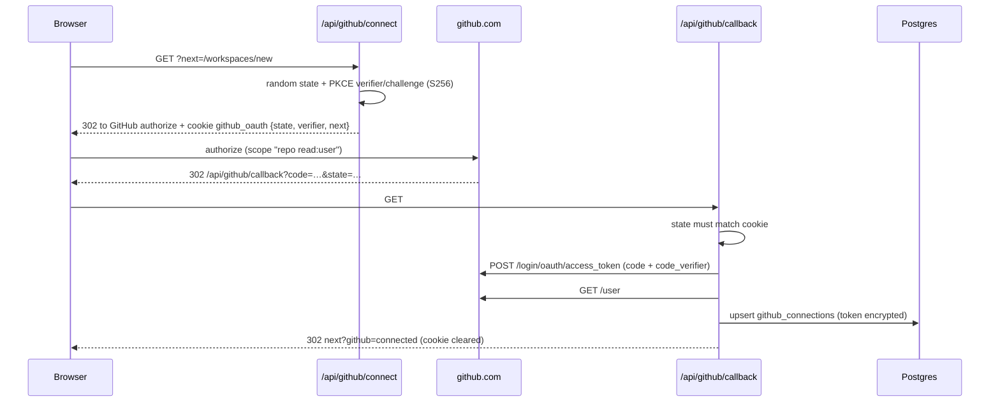

# GitHub integration

Everything that talks to GitHub: connecting an account, linking a repository, and syncing issues onto the board.
Code: [`lib/github.ts`](../lib/github.ts), [`lib/github-issues.ts`](../lib/github-issues.ts),
`app/api/github/*`, [`components/board/use-github-sync.ts`](../components/board/use-github-sync.ts).

- [Why a separate OAuth App](#why-a-separate-oauth-app)
- [Connecting an account](#connecting-an-account)
- [Token storage](#token-storage)
- [Linking a repository](#linking-a-repository)
- [Issue sync](#issue-sync)
- [Ownership rules](#ownership-rules)
- [Limits and costs](#limits-and-costs)
- [Errors](#errors)
- [Not supported yet](#not-supported-yet)

---

## Why a separate OAuth App

"Sign in with GitHub" goes through the hosted auth service, which never hands provider access tokens to the app.
Reading repositories and issues needs a token, so the app has its **own GitHub OAuth App** and its own "Connect
GitHub" step. A user can sign in with email and still connect GitHub, or sign in with GitHub and connect a
different GitHub account.

## Connecting an account

- **Scopes**: `repo` (read and push to private repositories — agents will need to push) and `read:user`.
- **CSRF**: a random `state` stored in the `github_oauth` cookie (HTTP-only, `SameSite=Lax`, path `/api/github`,
  10 minutes) must match what GitHub returns.
- **PKCE** (`S256`) protects the authorization code even if it leaks.
- **`next`** must be a same-origin path (`isSafeRedirectPath`); otherwise it defaults to `/workspaces/new`.
- **Outcome** is reported back as `?github=connected | denied | error | not-configured`, which the create-workspace
  page turns into a message.
- **Signed out** at any step → redirect to sign-in with `next` preserved.
- **Disconnect** (`disconnectGithub`) deletes the connection row. It doesn't revoke the authorization on GitHub;
  users can do that under GitHub → Settings → Applications.

## Token storage

Tokens are encrypted with **AES-256-GCM** before they touch the database (`lib/crypto.ts`):

- Key: `TOKEN_ENCRYPTION_KEY` (32 bytes, base64). A fresh 12-byte IV per encryption.
- Stored format: `v1.<iv>.<authTag>.<ciphertext>` (base64url parts). Tampering fails decryption.
- Only `getGithubToken(userId)` decrypts, and only on the server. Tokens are never sent to the browser or logged.
- Rotating the key makes existing tokens unreadable → the app treats it as "reconnect".

## Linking a repository

On `/workspaces/new`, once connected:

- `listLinkableRepos(token)` calls `GET /user/repos?affiliation=owner,collaborator,organization_member&sort=pushed`,
  up to **3 pages × 100**, and keeps repositories where `permissions.push === true` and `archived === false`.
- The list streams in after the page renders (Suspense) and is searchable on the client.
- On **Next**, `createWorkspace` receives only the repository's `owner/name`, validates its format, and **re-reads it
  from GitHub** (`GET /repos/{owner}/{repo}`) to confirm push access before saving the id, URL, default branch and
  visibility into `workspaces`.

## Issue sync

`syncWorkspaceIssues(workspace)` in `lib/github-issues.ts`, called by the `syncIssuesAction` server action.

**When** — the board calls it on mount (every visit or reload), on tab refocus after ≥ 15 s, every 60 s while the
tab is visible, and on **Refresh**. There are no webhooks (they'd need a public URL and admin rights on the repo).

**Steps**

1. Get the workspace **owner's** token. None → `not_connected`.
2. Fetch issues — *outside* any transaction, so no lock is held during network calls:
   `GET /repos/{owner}/{repo}/issues?sort=updated&direction=desc&per_page=100`, up to **5 pages**.
   - First sync (`github_issues_synced_at` is null): `state=open`.
   - Later syncs: `state=all&since=<github_issues_synced_at>` — only issues changed since then, open or closed.
   - Items with a `pull_request` key are skipped (GitHub returns PRs from the issues endpoint).
3. In one transaction, lock the workspace row (`FOR UPDATE`) and, oldest issue first:
   - **Unknown issue, open** → insert a card at the top of **Todo**: next `number`, type and priority from labels,
     title (or `Issue #N` if empty), body (≤ 5000 chars), labels (cleaned), GitHub fields.
   - **Unknown issue, closed** → skipped (never imported).
   - **Known card removed from the board** (`removed_at` set) → skipped forever.
   - **Known card, issue not changed** since `github_updated_at` → skipped.
   - **Known card, issue changed** → refresh GitHub-owned fields; and
     - closed on GitHub while the card isn't in Done → move it to the **end of Done** (counted as *closed*),
     - reopened on GitHub while the card is in Done → move it to the **top of Todo** (*reopened*),
     - otherwise counted as *updated*.
4. Store `github_issues_synced_at = start time − 60 s` (overlap covers clock skew; re-applying an issue is a no-op).
5. Return counts `{ added, updated, closed, reopened }`. The action returns the fresh board only if something changed
   (or the client asks for it), so idle polls don't re-render.

**Label rules** (applied once, at import)

| Labels (case-insensitive, word match) | Result |
| --- | --- |
| `bug`, `defect`, `regression`, `crash` | type **Bug** |
| `feature`, `enhancement`, `feature request` | type **Feature** |
| anything else / none | type **Issue** |
| `p0`, `urgent`, `critical`, `blocker` | priority **Urgent** |
| `p1`, `high` | priority **High** |
| `p3`, `p4`, `low`, `minor` | priority **Low** |
| anything else / none | priority **Medium** |

**Client behavior** (`useGithubSync`)
- Only one sync runs at a time.
- A fresh board is **never applied mid-drag or while a move/removal is saving** (it would undo the move on screen).
  The hook marks it deferred and fetches the board again once the board is idle.
- Auto-sync **pauses** on `not_connected`, `reconnect` and `no_access` (it can't succeed without the user); the
  Refresh button still works. Network errors keep retrying.

**Concurrency** — two tabs syncing at once are serialized by the workspace lock, and the unique constraint
`(workspace_id, github_issue_id)` makes duplicates impossible.

## Ownership rules

A synced card has two owners. These rules keep a sync from undoing anyone's work:

| Field | Owner | Effect |
| --- | --- | --- |
| Title, description, labels | **GitHub** | Refreshed when the issue changes. Read-only in the card dialog (with **Open** to edit on GitHub). `updateCardAction` validates and saves only board fields for synced cards. |
| Open / closed | **GitHub** | Closing → card to Done. Reopening → card back to Todo (only if it was in Done). |
| Column, position | **Board** | Never changed by a sync, except the close/reopen rule above. |
| Type, priority | **Board** | Guessed from labels at import, then yours. |
| Due date, assigned agent | **Board** | Never touched by a sync. |
| Removed | **Board** | A removed card stays removed, whatever happens to the issue. |

Cards created in the app have no GitHub issue (`github: null`) and are **not** pushed to GitHub.

## Limits and costs

- **500 issues per sync** (5 pages). A first sync of a repository with more open issues imports the 500 most
  recently updated; the rest arrive as they're updated.
- **API usage**: one request per page per sync. An open board polls once a minute, so roughly 60 requests/hour per
  open tab, against GitHub's 5,000/hour per user token.
- **Latency**: a new issue appears within about a minute on an open board (immediately on Refresh or a reload).

## Errors

| Situation | `reason` | Board shows |
| --- | --- | --- |
| Owner never connected GitHub, or disconnected | `not_connected` | "Connect GitHub to bring … issues onto the board." + **Connect GitHub** |
| Token revoked/expired (401), or `TOKEN_ENCRYPTION_KEY` changed | `reconnect` | "Your GitHub connection expired or was revoked." + **Reconnect GitHub** |
| Repo deleted, renamed, or access lost (403/404) | `no_access` | "We can't read issues from …" + **Try again** |
| Anything else (network, 5xx) | `error` | "We couldn't reach GitHub just now…" + **Try again** (auto-sync keeps retrying) |

During workspace creation, a 401 deletes the stale connection and asks to connect again; a 404 says the repository
no longer exists or access was lost.

## Not supported yet

- Webhooks / real-time updates.
- Writing back to GitHub (creating issues from app cards, closing issues from Done, comments).
- Pull requests on the board, assignees, milestones, or issue comments.
- Updating a workspace's repository metadata after a rename, or changing the linked repository.
- Syncing with the token of anyone but the workspace owner.
