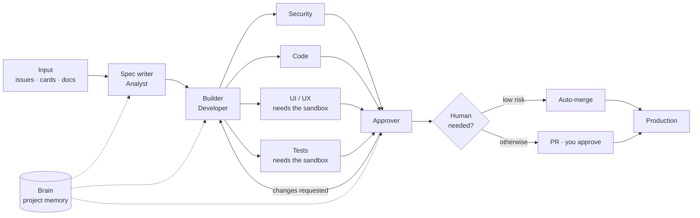

# Roadmap

Where TechTeam goes next (latest release: [v0.2.0](../CHANGELOG.md#020--2026-11-16)), and how a version is released.
For what works today see [status.md](status.md); for what's verified see [testing.md](testing.md).

- [Direction: an AI software factory](#direction-an-ai-software-factory)
- [Phases](#phases)
- [Backlog](#backlog)
- [Releasing](#releasing)

---

## Direction: an AI software factory

TechTeam already has the shape of a software factory: a standard input (issues and cards), specialized roles in a
line, quality gates with a rework loop, a standard output (a pull request), and cost and trust controls. The target
adds parallel specialist reviewers, a risk-based human gate, a shared memory and a path to production:



| Target piece | Today (v0.2) |
| --- | --- |
| Input | GitHub issues and board cards |
| Spec writer | Analyst (brief, questions to the owner) |
| Builder | Developer (branch + PR) |
| Specialist reviewers in parallel, mixed model companies | Reviewer and Security in parallel, then the Tester; one company per workspace |
| Approver with a loop back | Lead: combines the reviews, sends work back (max 2 rounds with the tests) |
| Risk-based human gate | Lead's risk rating with a deterministic floor; "Automatic when low risk" merge mode |
| Production | No deploy step |
| Brain | Only a card's earlier questions and answers |

Agents keep never writing to the default branch: low-risk changes still go through a PR, merged automatically.

## Phases

Each phase is a minor version. The order puts cheap wins on what exists first, then the pieces that unlock the rest.

### v0.2 — Smarter gates and live process ✅
- **Security and Lead agents**: Security reviews in parallel with the Reviewer (parallel Inngest steps); the Lead
  combines both verdicts, decides whether the Developer reworks and rates the change's risk (low, medium, high), with
  a deterministic floor from Security's findings and what the diff touches.
- **Risk-based human gate**: Settings → Merging adds "Automatic when low risk"; medium and high wait for the owner.
- **Live process** on the AI Team page (replaces the Live Agent Office) and face avatars for every agent.
- Released as **v0.2.0** (2026-11-16); see [CHANGELOG.md](../CHANGELOG.md#020--2026-11-16).

### v0.3 — Deploy and hardening
- Deploy (Vercel works: 300 s functions vs our 120 s routes; Postgres is already hosted). Hobby is non-commercial only.
  Needs Inngest Cloud, a production GitHub OAuth App and `PUBLIC_APP_URL` set to the production domain.
- Weekly Switch scans in production, without a tunnel.
- The post-MVP rows of the [test plan](testing.md#test-plan-and-status): Anthropic live, blocked merge, auto pickup
  and auto merge, pause or budget mid-run, Draft with AI, automatic provider switch.
- Drop the deprecated `workspaces.agent_auto_merge` column (replaced by `agent_merge_mode` in v0.2, kept one release
  so v0.1 code still runs against a migrated database).
- **Mixed companies per agent**: an agent may use OpenAI or Anthropic when both keys exist, so reviewers don't share
  one model's blind spots.

### v0.4 — Sandbox
- Run code in an isolated container: install, build and test before the PR; the Developer fixes what fails.
- Then **UI / UX reviewers** that look at the running app (screenshots in a headless browser). Without the sandbox they
  could only read code.

### v0.5 — Brain
- A project memory every agent reads before working: repository conventions, decisions, what earlier cards learned.
  Kept per workspace, editable by the owner.

### Later
- **Production** step after merge (deploy, check, roll back).
- Throughput: several cards at once per workspace.

## Backlog

Not tied to a phase yet:
- GitHub webhooks (real-time issues) and closing the issue when a card reaches Done.
- Integration tests: database + pipeline in simulated mode.
- Email notifications; GitHub syncs on the Activity page.
- Switch ROI usage tracking through the Switch SDK (Switch shows caps, not spend, until then).
- More inputs: documents, an external tracker.
- Landing page.

## Releasing

1. Every pull request adds its user-visible changes under **Unreleased** in [CHANGELOG.md](../CHANGELOG.md).
2. To release, on a `release/vX.Y.Z` branch: move the Unreleased entries under `## [X.Y.Z] — <date>`, set
   `"version"` in `package.json`, update the compare links at the bottom of the changelog, and update
   [status.md](status.md) and this roadmap.
3. Open the PR, wait for CI, merge it into `main`.
4. Tag the merge commit and push the tag:
   ```bash
   git checkout main && git pull
   git tag -a vX.Y.Z -m "TechTeam vX.Y.Z"
   git push origin vX.Y.Z
   ```
5. On GitHub → **Releases** → **Draft a new release**, pick the tag, and paste the version's changelog section.

Versions stay `0.x` until TechTeam runs in production; breaking database changes always ship with a migration.
