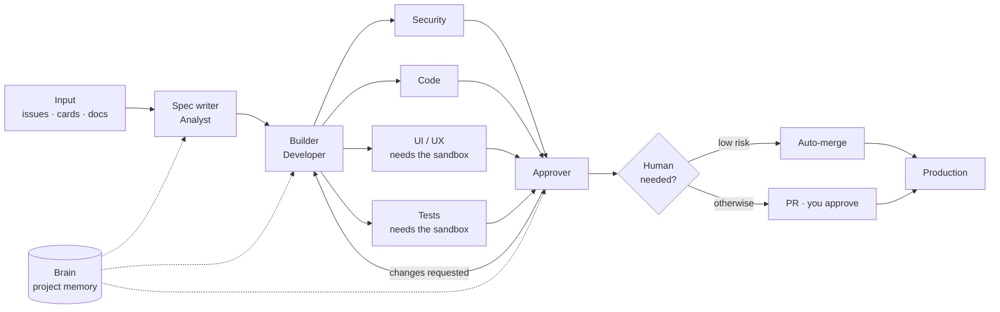

# Roadmap

Where TechTeam goes next (latest release: [v0.5.0](../CHANGELOG.md#050--2026-11-19)), and how a version is released.
For what works today see [status.md](status.md); for what's verified see [testing.md](testing.md).

- [Direction: an AI software factory](#direction-an-ai-software-factory)
- [Phases](#phases)
- [Backlog](#backlog)
- [Releasing](#releasing)

---

## Direction: an AI software factory

TechTeam already has the shape of a software factory: a standard input (issues and cards), specialized roles in a
line, quality gates with a rework loop, a standard output (a pull request), and cost and trust controls. The target
adds parallel specialist reviewers, a risk-based human gate, a shared memory and a path to production:



| Target piece | Today (v0.5) |
| --- | --- |
| Input | GitHub issues and board cards |
| Spec writer | Analyst (brief, questions to the owner) |
| Builder | Developer (branch + PR) runs the tests and the build in a sandbox before review; CI on the PR checked too, failures go back to it |
| Specialist reviewers in parallel, mixed model companies | Reviewer and Security in parallel, then the Tester; each agent picks its own company and model (OpenAI, Anthropic, OpenRouter) |
| Approver with a loop back | Lead: combines the reviews, sends work back (max 2 rework rounds, shared with the tests and CI) |
| Risk-based human gate | Lead's risk rating with a deterministic floor; "Automatic when low risk" merge mode |
| Production | No deploy step |
| Brain | Only a card's earlier questions and answers; agent skills (v0.3) bring curated technical and practice knowledge |

Agents keep never writing to the default branch: low-risk changes still go through a PR, merged automatically.

## Phases

Each phase is a minor version. The order puts cheap wins on what exists first, then the pieces that unlock the rest.

### v0.2 — Smarter gates and live process ✅
- **Security and Lead agents**: Security reviews in parallel with the Reviewer (parallel Inngest steps); the Lead
  combines both verdicts, decides whether the Developer reworks and rates the change's risk (low, medium, high), with
  a deterministic floor from Security's findings and what the diff touches.
- **Risk-based human gate**: Settings → Merging adds "Automatic when low risk"; medium and high wait for the owner.
- **Live process** on the AI Team page (replaces the Live Agent Office) and face avatars for every agent.
- Released as **v0.2.0** (2026-11-16); see [CHANGELOG.md](../CHANGELOG.md#020--2026-11-16).

### v0.3 — Agent skills
- **Permissions vs. skills**: what the app called skills (repo.read, code.write …, enforced as tools) are now
  **permissions**; **skills** are installable knowledge packs in the Agent Skills format (SKILL.md + reference files),
  *technical* or *practice*, loaded *always* (short playbooks in the prompt) or *on demand* (searched and read).
- **Built-ins** vendored at pinned commits by `npm run skills:sync` (reviewed by pull request, never fetched at
  runtime): `modern-web-guidance` (on for Developer, Reviewer, Security) and `chrome-extensions` (off).
- **Uploads** in Settings → Agent skills: validation, deterministic security scan, AI review and classification,
  confirm with *Assign to*; per-agent switches in AI Team → Configure; findings count in the trust score.
- Agents use them in every stage through two read-only tools (`search_skill`, `read_skill`) on both providers.
- Released as **v0.3.0** (2026-11-17); see [CHANGELOG.md](../CHANGELOG.md#030--2026-11-17).

### v0.4 — CI in the loop and metrics
- **CI gate**: after each push the pipeline waits for the pull request's checks; a check the change broke goes back to
  the Developer with its output before review. Checks already red on the default branch don't block.
- **Metrics page**: delivered, success and first-pass rates, CI pass rate, cost per delivered card, outcomes, rework
  causes, spend by agent.
- Board columns that scroll inside with **Show N more**; fixes to the automatic provider switch and auto pickup.
- Released as **v0.4.0** (2026-11-18); see [CHANGELOG.md](../CHANGELOG.md#040--2026-11-18).

### v0.5 — Sandbox, previews and account keys ✅
- **Agent sandbox**: the Developer and the Tester run the repository's tests, build or a command in throwaway gVisor
  containers on a VPS (`deploy/setup.sh`); install with network, the code without (live run 49).
- **Previews**: each agent PR runs at `https://pr-<n>-<random>.preview.<domain>` over HTTPS (Caddy) once CI passes,
  stopped on merge or close or after 2 hours; **the Tester tries it in a headless browser** with screenshots in the
  agent log (live run 51).
- **AI keys on the account**, spending across projects, a **company and model per agent**, and **OpenRouter** as a
  third company (Google, DeepSeek, Z.ai, xAI, Moonshot; live run 50).
- The VPS: keys-only SSH, firewall, containers kept off the host's services.
- Released as **v0.5.0** (2026-11-19); see [CHANGELOG.md](../CHANGELOG.md#050--2026-11-19).

### v0.6 — Deploy and hardening
Run TechTeam itself on the VPS, so nothing has to run on a laptop: open `https://app.<domain>` from any computer.
- The app (Next.js standalone) and a self-hosted Inngest as services on the VPS behind the same Caddy, restarting on
  boot; Postgres and auth stay on Cloudhike. A production GitHub OAuth App, `PUBLIC_APP_URL`, backups (`pg_dump`).
- Weekly Switch scans in production, without a tunnel; GitHub webhooks instead of the 60 s issue sync.
- The post-MVP rows of the [test plan](testing.md#test-plan-and-status): Anthropic live, mixed three-company run,
  blocked merge, auto pickup and auto merge, pause or budget mid-run, Draft with AI, automatic provider switch.
- Skill uploads out of a Server Action, so `serverActions.bodySizeLimit` goes back to the 1 MB default.
- **Project skills**: read skills from the linked repository (e.g. `.agents/skills/`, `.claude/skills/`) as a third
  source (`agent_skills.source = 'project'` is reserved), scanned like uploads.

### v0.7 — Card references and sandbox polish
The owner designs and specifies outside TechTeam (a design tool, a document); the agents build from it. Tested against
`techteam-sandbox-demo`.
1. **References on a card**
   - Attach images (PNG, JPEG, WebP), Markdown or text and PDFs to a card, plus reference URLs. Private S3 like logos,
     served through owner-checked routes; limits on count and size. Files and extracted PDF text live in S3; the
     database keeps only a small row per reference. Removing the card deletes its references.
   - A reference URL is captured once, when it's added (screenshot + page outline, by the sandbox browser with network
     but no access to anything internal), and kept as an attachment: agents never browse the internet.
   - Agents read references on demand, like skills (`list_references` / `read_reference`): Markdown and PDF text as
     text, images as image input. The Analyst's brief says which references matter; the Developer follows them.
   - Models that see images are flagged in `AGENT_MODELS`; Run warns when a card has images and the Developer's model
     can't see them (DeepSeek can't). Image input per provider (OpenAI, Anthropic, OpenRouter), also from tool results.
   - References are the owner's requirements but still data: they can't change the operating protocol or add tools.
   - Done: files (phase 1) and links (`lib/sandbox/capture.ts`: a checking proxy keeps the browser off private
     networks; the Tester also counts in the vision check while previews are on).
2. **The Tester compares with the reference**: screenshots of the preview at the reference's size (375 / 768 / 1280 px,
   light and dark) seen next to it; a clear difference is a test fail and goes back to the Developer. Feeding the
   Tester's own screenshots to its model comes with this (today they only reach the agent log).
   Done in code (tablet viewport, color scheme, screenshots as image input, the testing protocol); not yet seen live.
3. **A UI/UX skill**: a built-in design skill (vendored with its license) for the Developer and the Tester, so a rough
   image becomes a good page (spacing, states, accessibility, mobile, dark mode) instead of a copy of its flaws.
   Done: `interface-design` (Dammyjay93/interface-design, MIT), with a usage note for references and the preview.
4. **Sandbox polish**
   - Sandbox numbers on the Metrics page; limits per workspace; cleanup of stale containers, previews, images and
     screenshot objects (they stay in S3 today).
   - Still unseen live: the Developer fixing a failure it found.
   - Merge conflicts: the follow-up card a conflict files ("Fix merge of PR #n") can't be done by the agents. They have
     no tool to bring the default branch into a PR branch, and running that card starts a new branch instead of fixing
     the PR. Seen live 2026-11-19: SAN-2's PR #2 conflicted after SAN-3 and SAN-4 merged (SAN-5, issue #5).
   - `add_dependency` (gated by `deps.manage`): installs a package in the sandbox with network and commits the
     manifest and the lockfile to the branch. Today an agent can't add one: it can't regenerate the lockfile, so
     `npm ci` fails. First use: a font the owner names in the card (`@fontsource/…`), bundled into the build, so it
     loads in the preview (no internet there, so a Google Fonts `<link>` falls back) and no visitor request goes to a
     font host. The owner picks fonts in the card's description; agents don't choose one on their own.
     Done in code (npm only, lockfile-only install without scripts, one commit through the GitHub API; checked on
     the sandbox host); not yet seen in a live run.
   - Done: the capture network's private-range rules for the sandbox's install step too (`techteam-sandbox`, public
     resolvers; the rules apply once `deploy/setup.sh` runs again on the host).
   - Done: fonts with real bold weights in the browser image (`techteam-browser:1.64.1-3`: Inter for `system-ui`
     stacks; run 52's screenshots showed `system-ui` headings and a 700-weight amount as regular).
   - A Docker socket proxy for Caddy; an optional login in front of previews for private apps; a slimmer browser
     image pinned by digest; Draft with AI aware of the browser; git history inside the sandbox (`git diff` fails on a
     tarball checkout).
5. Docs, test plan rows, CHANGELOG, release **v0.7.0**.

### v0.8 — Brain
- A project memory every agent reads before working: repository conventions, decisions, what earlier cards learned.
  Kept per workspace, editable by the owner.

### Later
- **Designer agent**: builds on v0.7's references and image input. Design QA first (the preview against the approved
  reference), then a Design phase before development: two or three directions from the card's prompt as HTML mockups,
  improved by looking at their own screenshots, and the owner picks one before the Developer starts.
- **Production** step after merge (deploy, check, roll back).
- Throughput: several cards at once per workspace.

## Backlog

Not tied to a phase yet:
- More built-in skills (practice playbooks for reviews, security and testing), and semantic search over skills.
- Rename the `agents.skills` column to `permissions` once no older code runs against the database.
- GitHub webhooks (real-time issues) and closing the issue when a card reaches Done.
- Integration tests: database + pipeline in simulated mode.
- Email notifications; GitHub syncs on the Activity page.
- Switch ROI usage tracking through the Switch SDK (Switch shows caps, not spend, until then).
- More inputs: documents, an external tracker.
- Landing page.

## Releasing

1. Every pull request adds its user-visible changes under **Unreleased** in [CHANGELOG.md](../CHANGELOG.md).
2. To release, on a `release/vX.Y.Z` branch: move the Unreleased entries under `## [X.Y.Z] — <date>`, set
   `"version"` in `package.json`, update the compare links at the bottom of the changelog, and update
   [status.md](status.md) and this roadmap.
3. Open the PR, wait for CI, merge it into `main`.
4. Tag the merge commit and push the tag:
   ```bash
   git checkout main && git pull
   git tag -a vX.Y.Z -m "TechTeam vX.Y.Z"
   git push origin vX.Y.Z
   ```
5. On GitHub → **Releases** → **Draft a new release**, pick the tag, and paste the version's changelog section.

Versions stay `0.x` until TechTeam runs in production; breaking database changes always ship with a migration.
