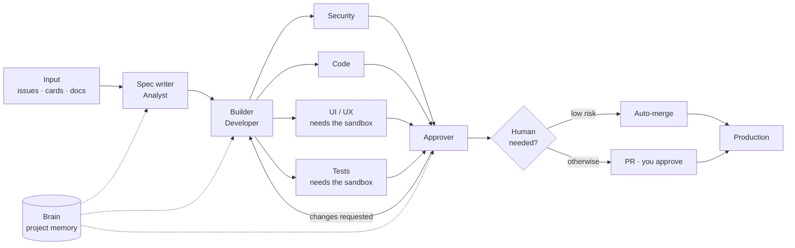

# Roadmap

Where TechTeam goes next (latest release: [v0.4.0](../CHANGELOG.md#040--2026-11-18)), and how a version is released.
For what works today see [status.md](status.md); for what's verified see [testing.md](testing.md).

- [Direction: an AI software factory](#direction-an-ai-software-factory)
- [Phases](#phases)
- [Backlog](#backlog)
- [Releasing](#releasing)

---

## Direction: an AI software factory

TechTeam already has the shape of a software factory: a standard input (issues and cards), specialized roles in a
line, quality gates with a rework loop, a standard output (a pull request), and cost and trust controls. The target
adds parallel specialist reviewers, a risk-based human gate, a shared memory and a path to production:



| Target piece | Today (v0.4) |
| --- | --- |
| Input | GitHub issues and board cards |
| Spec writer | Analyst (brief, questions to the owner) |
| Builder | Developer (branch + PR); CI on the PR checked before review, failures go back to it |
| Specialist reviewers in parallel, mixed model companies | Reviewer and Security in parallel, then the Tester; each agent picks its own company and model (v0.6) |
| Approver with a loop back | Lead: combines the reviews, sends work back (max 2 rework rounds, shared with the tests and CI) |
| Risk-based human gate | Lead's risk rating with a deterministic floor; "Automatic when low risk" merge mode |
| Production | No deploy step |
| Brain | Only a card's earlier questions and answers; agent skills (v0.3) bring curated technical and practice knowledge |

Agents keep never writing to the default branch: low-risk changes still go through a PR, merged automatically.

## Phases

Each phase is a minor version. The order puts cheap wins on what exists first, then the pieces that unlock the rest.

### v0.2 — Smarter gates and live process ✅
- **Security and Lead agents**: Security reviews in parallel with the Reviewer (parallel Inngest steps); the Lead
  combines both verdicts, decides whether the Developer reworks and rates the change's risk (low, medium, high), with
  a deterministic floor from Security's findings and what the diff touches.
- **Risk-based human gate**: Settings → Merging adds "Automatic when low risk"; medium and high wait for the owner.
- **Live process** on the AI Team page (replaces the Live Agent Office) and face avatars for every agent.
- Released as **v0.2.0** (2026-11-16); see [CHANGELOG.md](../CHANGELOG.md#020--2026-11-16).

### v0.3 — Agent skills
- **Permissions vs. skills**: what the app called skills (repo.read, code.write …, enforced as tools) are now
  **permissions**; **skills** are installable knowledge packs in the Agent Skills format (SKILL.md + reference files),
  *technical* or *practice*, loaded *always* (short playbooks in the prompt) or *on demand* (searched and read).
- **Built-ins** vendored at pinned commits by `npm run skills:sync` (reviewed by pull request, never fetched at
  runtime): `modern-web-guidance` (on for Developer, Reviewer, Security) and `chrome-extensions` (off).
- **Uploads** in Settings → Agent skills: validation, deterministic security scan, AI review and classification,
  confirm with *Assign to*; per-agent switches in AI Team → Configure; findings count in the trust score.
- Agents use them in every stage through two read-only tools (`search_skill`, `read_skill`) on both providers.
- Released as **v0.3.0** (2026-11-17); see [CHANGELOG.md](../CHANGELOG.md#030--2026-11-17).

### v0.4 — CI in the loop and metrics
- **CI gate**: after each push the pipeline waits for the pull request's checks; a check the change broke goes back to
  the Developer with its output before review. Checks already red on the default branch don't block.
- **Metrics page**: delivered, success and first-pass rates, CI pass rate, cost per delivered card, outcomes, rework
  causes, spend by agent.
- Board columns that scroll inside with **Show N more**; fixes to the automatic provider switch and auto pickup.
- Released as **v0.4.0** (2026-11-18); see [CHANGELOG.md](../CHANGELOG.md#040--2026-11-18).

### v0.5 — Deploy and hardening
- Deploy (Vercel works: 300 s functions vs our 120 s routes; Postgres is already hosted). Hobby is non-commercial only.
  Needs Inngest Cloud, a production GitHub OAuth App and `PUBLIC_APP_URL` set to the production domain.
- Weekly Switch scans in production, without a tunnel.
- The post-MVP rows of the [test plan](testing.md#test-plan-and-status): Anthropic live, blocked merge, auto pickup
  and auto merge, pause or budget mid-run, Draft with AI, automatic provider switch.
- Skill uploads under Vercel's 4.5 MB request limit: move the upload out of a Server Action (a route handler or a
  direct upload to S3) so `serverActions.bodySizeLimit` goes back to the 1 MB default for every other action. Next.js
  only sets that limit globally.
- **Project skills**: read skills from the linked repository (e.g. `.agents/skills/`, `.claude/skills/`) as a third
  source (`agent_skills.source = 'project'` is reserved), scanned like uploads.
- ~~**Mixed companies per agent**~~: done early (2026-11-19, `feat/account-settings`): each agent picks its company
  and model, and AI keys live on the account.

### v0.6 — Sandbox
Agents run the code, not only read it. Sandboxes are throwaway Docker containers under gVisor on a VPS
(`deploy/setup.sh`), driven over SSH; the repository goes in as a tarball, so no token ever enters a container. Built in
four milestones on the `feat/sandbox` branch, tested against `techteam-sandbox-demo` (Vite + TypeScript, tests, build,
CI).

1. **Run code**
   - VPS ready: Docker, gVisor, firewall, keys-only SSH ✅. Test repository with tests, build and CI ✅.
   - `lib/sandbox/`: one interface, a Docker-over-SSH implementation. CPU, memory, process and time limits; output
     clipped; no network for the code (install only) ✅.
   - Settings → Sandbox: on/off, install / test / build commands detected from `package.json`, editable ✅.
   - Tools behind the existing `tests.run` permission: `run_tests`, `run_build`, `run_command` for the Developer
     (fix what fails before review) and the Tester (runs the tests itself, not only CI). The agent log records each
     command, its exit code and duration, never its output ✅.
   - Simulated mode scripts a sandbox call ✅; one live run on the test repository ✅ (run 49, $0.17). Still unseen:
     the Developer fixing a failure it found (everything passed first time).
2. **Preview and a browser for the Tester**
   - A preview of each agent PR on `pr-<n>.preview.<domain>` (needs a domain with wildcard DNS), stopped when the PR
     closes or after a time limit.
   - The Tester drives it in headless Chromium (Playwright): steps, console errors, screenshots in the agent log.
3. **Designer agent** (seventh role, a reviewer first)
   - Reviews in parallel with the Reviewer and Security: screenshots of the changed pages at 375 / 768 / 1280 px in
     light and dark, read by a vision model; findings go to the Lead.
   - Face, defaults, AI Team card, live process and metrics like every role.
4. **Polish and release**
   - Sandbox numbers on the Metrics page; limits per workspace; cleanup of stale containers, previews and images.
   - Docs, test plan rows, CHANGELOG, release **v0.6.0**.

### v0.7 — Brain
- A project memory every agent reads before working: repository conventions, decisions, what earlier cards learned.
  Kept per workspace, editable by the owner.

### Later
- **Production** step after merge (deploy, check, roll back).
- Throughput: several cards at once per workspace.

## Backlog

Not tied to a phase yet:
- More built-in skills (practice playbooks for reviews, security and testing), and semantic search over skills.
- Rename the `agents.skills` column to `permissions` once no older code runs against the database.
- GitHub webhooks (real-time issues) and closing the issue when a card reaches Done.
- Integration tests: database + pipeline in simulated mode.
- Email notifications; GitHub syncs on the Activity page.
- Switch ROI usage tracking through the Switch SDK (Switch shows caps, not spend, until then).
- More inputs: documents, an external tracker.
- Landing page.

## Releasing

1. Every pull request adds its user-visible changes under **Unreleased** in [CHANGELOG.md](../CHANGELOG.md).
2. To release, on a `release/vX.Y.Z` branch: move the Unreleased entries under `## [X.Y.Z] — <date>`, set
   `"version"` in `package.json`, update the compare links at the bottom of the changelog, and update
   [status.md](status.md) and this roadmap.
3. Open the PR, wait for CI, merge it into `main`.
4. Tag the merge commit and push the tag:
   ```bash
   git checkout main && git pull
   git tag -a vX.Y.Z -m "TechTeam vX.Y.Z"
   git push origin vX.Y.Z
   ```
5. On GitHub → **Releases** → **Draft a new release**, pick the tag, and paste the version's changelog section.

Versions stay `0.x` until TechTeam runs in production; breaking database changes always ship with a migration.
