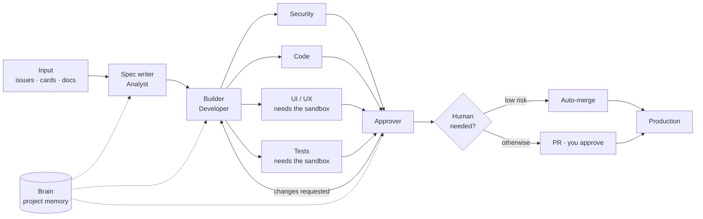

# Roadmap

Where TechTeam goes next (latest release: [v0.5.0](../CHANGELOG.md#050--2026-11-19)), and how a version is released.
For what works today see [status.md](status.md); for what's verified see [testing.md](testing.md).

- [Direction: an AI software factory](#direction-an-ai-software-factory)
- [Phases](#phases)
- [Backlog](#backlog)
- [Releasing](#releasing)

---

## Direction: an AI software factory

TechTeam already has the shape of a software factory: a standard input (issues and cards), specialized roles in a
line, quality gates with a rework loop, a standard output (a pull request), and cost and trust controls. The target
adds parallel specialist reviewers, a risk-based human gate, a shared memory and a path to production:



| Target piece | Today (v0.5) |
| --- | --- |
| Input | GitHub issues and board cards |
| Spec writer | Analyst (brief, questions to the owner) |
| Builder | Developer (branch + PR) runs the tests and the build in a sandbox before review; CI on the PR checked too, failures go back to it |
| Specialist reviewers in parallel, mixed model companies | Reviewer and Security in parallel, then the Tester; each agent picks its own company and model (OpenAI, Anthropic, OpenRouter) |
| Approver with a loop back | Lead: combines the reviews, sends work back (max 2 rework rounds, shared with the tests and CI) |
| Risk-based human gate | Lead's risk rating with a deterministic floor; "Automatic when low risk" merge mode |
| Production | No deploy step |
| Brain | Only a card's earlier questions and answers; agent skills (v0.3) bring curated technical and practice knowledge |

Agents keep never writing to the default branch: low-risk changes still go through a PR, merged automatically.

## Phases

Each phase is a minor version. The order puts cheap wins on what exists first, then the pieces that unlock the rest.

### v0.2 — Smarter gates and live process ✅
- **Security and Lead agents**: Security reviews in parallel with the Reviewer (parallel Inngest steps); the Lead
  combines both verdicts, decides whether the Developer reworks and rates the change's risk (low, medium, high), with
  a deterministic floor from Security's findings and what the diff touches.
- **Risk-based human gate**: Settings → Merging adds "Automatic when low risk"; medium and high wait for the owner.
- **Live process** on the AI Team page (replaces the Live Agent Office) and face avatars for every agent.
- Released as **v0.2.0** (2026-11-16); see [CHANGELOG.md](../CHANGELOG.md#020--2026-11-16).

### v0.3 — Agent skills
- **Permissions vs. skills**: what the app called skills (repo.read, code.write …, enforced as tools) are now
  **permissions**; **skills** are installable knowledge packs in the Agent Skills format (SKILL.md + reference files),
  *technical* or *practice*, loaded *always* (short playbooks in the prompt) or *on demand* (searched and read).
- **Built-ins** vendored at pinned commits by `npm run skills:sync` (reviewed by pull request, never fetched at
  runtime): `modern-web-guidance` (on for Developer, Reviewer, Security) and `chrome-extensions` (off).
- **Uploads** in Settings → Agent skills: validation, deterministic security scan, AI review and classification,
  confirm with *Assign to*; per-agent switches in AI Team → Configure; findings count in the trust score.
- Agents use them in every stage through two read-only tools (`search_skill`, `read_skill`) on both providers.
- Released as **v0.3.0** (2026-11-17); see [CHANGELOG.md](../CHANGELOG.md#030--2026-11-17).

### v0.4 — CI in the loop and metrics
- **CI gate**: after each push the pipeline waits for the pull request's checks; a check the change broke goes back to
  the Developer with its output before review. Checks already red on the default branch don't block.
- **Metrics page**: delivered, success and first-pass rates, CI pass rate, cost per delivered card, outcomes, rework
  causes, spend by agent.
- Board columns that scroll inside with **Show N more**; fixes to the automatic provider switch and auto pickup.
- Released as **v0.4.0** (2026-11-18); see [CHANGELOG.md](../CHANGELOG.md#040--2026-11-18).

### v0.5 — Sandbox, previews and account keys ✅
- **Agent sandbox**: the Developer and the Tester run the repository's tests, build or a command in throwaway gVisor
  containers on a VPS (`deploy/setup.sh`); install with network, the code without (live run 49).
- **Previews**: each agent PR runs at `https://pr-<n>-<random>.preview.<domain>` over HTTPS (Caddy) once CI passes,
  stopped on merge or close or after 2 hours; **the Tester tries it in a headless browser** with screenshots in the
  agent log (live run 51).
- **AI keys on the account**, spending across projects, a **company and model per agent**, and **OpenRouter** as a
  third company (Google, DeepSeek, Z.ai, xAI, Moonshot; live run 50).
- The VPS: keys-only SSH, firewall, containers kept off the host's services.
- Released as **v0.5.0** (2026-11-19); see [CHANGELOG.md](../CHANGELOG.md#050--2026-11-19).

### v0.7 — Card references and sandbox polish ✅
The owner designs and specifies outside TechTeam (a design tool, a document); the agents build from it.
- **References on cards**: images, Markdown, text and PDFs (files and PDF text in S3, removed with the card), and
  **links captured once** by the sandbox browser behind a checking proxy (desktop and mobile screenshots plus an
  outline). Agents read them with `list_references` / `read_reference`; Run refuses when a stage's model can't see them
  (live runs 52, AJU-22, AJU-23).
- **The Tester compares the preview with the references** at their size, light and dark, and sees its own screenshots
  (live run 52); the built-in **`interface-design`** skill for the Developer and the Tester.
- **Sandbox polish**: the install step on its own network kept off private ranges (`deploy/setup.sh`), real bold fonts
  in the browser image, **`add_dependency`** (npm, lockfile only, no install scripts), and agents **fix merge
  conflicts** on their own PRs (follow-up cards continue the PR; two-parent merge commits through the GitHub API).
- **Leaner agent turns**: older turns folded on OpenRouter, context editing on Claude, compaction on OpenAI, batched tool
  calls; a stage never loses its work to the turn limit, and a rerun continues the unfinished branch or PR (live runs
  53–55: the Developer's cost per turn went from $0.022 to $0.0056).
- Not yet seen live: `add_dependency`, conflict resolution (testing.md rows 71–78).
- Released as **v0.7.0** (2026-11-20, before v0.6); see [CHANGELOG.md](../CHANGELOG.md#070--2026-11-20).

### v0.8 — Agents on your plans (local CLIs)
TechTeam stays a web app; when it runs on the owner's own computer, agents can work on the owner's subscription through
the official CLI installed there, next to API keys ([cli-agents.md](cli-agents.md), plan: [cli-agents-plan.md](cli-agents-plan.md)).
- **Claude Code** first: Settings → AI → Plans on this computer (switch per computer, TechTeam's own login, confirmed
  account), route resolution per stage (the model stays the agent's), TechTeam's tools over a local MCP endpoint,
  chunks of turns resumed by session, plan usage instead of spend, the plan-limit choice (wait and resume, API key,
  switch company), two computers on one database (one run per card, `AGENTS_AUTO_PICKUP`), Windows in CI.
- To do before release: the isolation check and one live run with the owner's OK (the Developer on a Claude model
  through the plan, the rest on OpenRouter; then on the Windows PC).
- Next on the same rules: **Codex** for OpenAI models on a ChatGPT plan.

### v0.9 — Brain
- A project memory every agent reads before working: repository conventions, decisions, what earlier cards learned.
  Markdown in the linked repository (`.techteam/memory/`), so both computers share it through GitHub; agents only
  propose changes in their card's PR (see cli-agents-plan.md §6).

### Later
- **Deploy and hardening** (was v0.6; moved here 2026-11-20, agents on local plans first):
  Run TechTeam itself on the VPS, so nothing has to run on a laptop: open `https://app.<domain>` from any computer.
  - The app (Next.js standalone) and a self-hosted Inngest as services on the VPS behind the same Caddy, restarting on
    boot; Postgres and auth stay on Cloudhike. A production GitHub OAuth App, `PUBLIC_APP_URL`, backups (`pg_dump`).
  - Weekly Switch scans in production, without a tunnel; GitHub webhooks instead of the 60 s issue sync.
  - The post-MVP rows of the [test plan](testing.md#test-plan-and-status): Anthropic live, mixed three-company run,
    blocked merge, auto pickup and auto merge, pause or budget mid-run, Draft with AI, automatic provider switch.
  - Skill uploads out of a Server Action, so `serverActions.bodySizeLimit` goes back to the 1 MB default.
  - **Project skills**: read skills from the linked repository (e.g. `.agents/skills/`, `.claude/skills/`) as a third
    source (`agent_skills.source = 'project'` is reserved), scanned like uploads.
- **Designer agent**: builds on v0.7's references and image input. Design QA first (the preview against the approved
  reference), then a Design phase before development: two or three directions from the card's prompt as HTML mockups,
  improved by looking at their own screenshots, and the owner picks one before the Developer starts.
- **Production** step after merge (deploy, check, roll back).
- Throughput: several cards at once per workspace.

## Backlog

Not tied to a phase yet:
- More built-in skills (practice playbooks for reviews, security and testing), and semantic search over skills.
- Rename the `agents.skills` column to `permissions` once no older code runs against the database.
- GitHub webhooks (real-time issues) and closing the issue when a card reaches Done.
- Integration tests: database + pipeline in simulated mode.
- Email notifications; GitHub syncs on the Activity page.
- Switch ROI usage tracking through the Switch SDK (Switch shows caps, not spend, until then).
- More inputs: documents, an external tracker.
- Landing page.
- Sandbox numbers on the Metrics page; limits per workspace; cleanup of stale containers, previews, images and
  screenshot objects.
- A Docker socket proxy for Caddy; an optional login in front of previews for private apps; a slimmer browser image
  pinned by digest; Draft with AI aware of the browser; git history inside the sandbox.
- Resolving one conflict section at a time, and binary conflicts by picking a side.

## Releasing

1. Every pull request adds its user-visible changes under **Unreleased** in [CHANGELOG.md](../CHANGELOG.md).
2. To release, on a `release/vX.Y.Z` branch: move the Unreleased entries under `## [X.Y.Z] — <date>`, set
   `"version"` in `package.json`, update the compare links at the bottom of the changelog, and update
   [status.md](status.md) and this roadmap.
3. Open the PR, wait for CI, merge it into `main`.
4. Tag the merge commit and push the tag:
   ```bash
   git checkout main && git pull
   git tag -a vX.Y.Z -m "TechTeam vX.Y.Z"
   git push origin vX.Y.Z
   ```
5. On GitHub → **Releases** → **Draft a new release**, pick the tag, and paste the version's changelog section.

Versions stay `0.x` until TechTeam runs in production; breaking database changes always ship with a migration.
