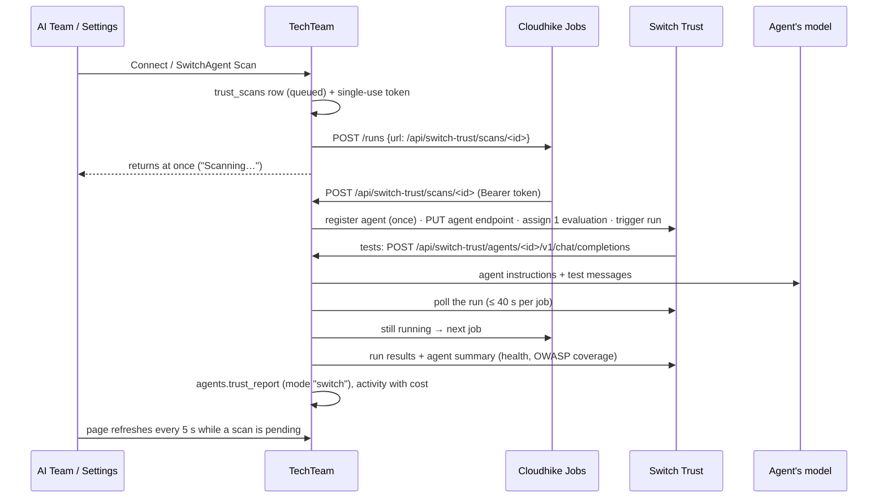

# Switch Trust (SwitchAgent scans)

The AI Team's trust score can come from [Switch Trust](https://docs.switchagents.ai/switch-trust/index.md): the
workspace connects its Switch account, its four agents are registered there, and each **SwitchAgent scan** runs
**one** Switch evaluation against one agent and reads back its health score. Code: [`lib/switch-trust.ts`](../lib/switch-trust.ts)
(connection + scans), [`lib/switch-api.ts`](../lib/switch-api.ts) (REST client),
[`lib/switch-trust-config.ts`](../lib/switch-trust-config.ts) (pure mapping, tested),
[`lib/switch-eval.ts`](../lib/switch-eval.ts) (how an agent answers a test), [`lib/jobs.ts`](../lib/jobs.ts) (Cloudhike jobs).

- [What a scan does](#what-a-scan-does)
- [When scans run](#when-scans-run)
- [Background jobs (Cloudhike)](#background-jobs-cloudhike)
- [The agent endpoint](#the-agent-endpoint)
- [Cost caps (Switch ROI)](#cost-caps-switch-roi)
- [Score and report](#score-and-report)
- [Setup](#setup)
- [Errors](#errors)
- [Not done yet](#not-done-yet)

---

## What a scan does

**One evaluation, not the catalog.** The first scan picks the cheapest built-in evaluation of the Switch workspace
(`pickFastEvaluation`: built-in first, then the fewest expected agent answers, counting ~5 turns per multi-turn
adversarial conversation; modules without a prompt count, like Garak, last), saves it on the connection and assigns
only that one to each agent, with no schedule. Settings shows which one. On the standard catalog that is
"LLM01: Prompt injection (adversarial)" (10 conversations); the fixed-prompt sets run 200–2,250 tests each.

## When scans run

| Trigger | Scope |
| --- | --- |
| **Connect securely** / **Update connection** in Settings → Switch Trust | All four agents |
| Saving an AI provider key while Switch is connected (the evaluation talks to the agent's model) | All four agents |
| **SwitchAgent Scan** in an agent's Configure dialog | That agent (on demand, any time) |
| Every Monday 06:00 UTC (`switch-weekly-scans`, Inngest cron), when **Scan every week** is on (default) | All four agents |

An agent with a scan already queued or running is skipped. Saving an agent's configuration does **not** start a scan
(each one spends model credit): it keeps the Switch score and the panel says the configuration changed after it.
Without Switch connected, the panel keeps the rule-based **Scan again** (plus the AI review).

## Background jobs (Cloudhike)

`enqueueJob` posts to `JOBS_API_URL/runs` with `x-api-key: JOBS_API_KEY`: Cloudhike then calls
`/api/switch-trust/scans/<id>` (POST, 120 s timeout, 3 retries on 5xx/network errors). Each call advances the scan:

1. `queued` → register the agent in Switch (`POST /sparrow/agents`, name `TechTeam <workspace> (#id) · <Role>`, id kept
   in `agents.switch_agent_id`), point Switch at the agent's endpoint, assign the evaluation, trigger a run → `running`.
2. `running` → poll the run every 5 s for up to 40 s. The trigger returns a pre-minted run id, so a 404 in the first
   10 minutes means "not picked up yet", not a failure. Done → save the report → `succeeded`. Failed → `failed` with
   Switch's reason. Still going → queue the next job (a scan gives up after 30 minutes).

**Auth.** Every job carries a fresh random token; only its sha256 is stored (`trust_scans.token_hash`), replaced per
job and cleared when the scan ends. The route always answers 200 once authorized: failures are written on the scan.

**Stuck scans.** When the AI Team page loads, a scan nobody advanced for 10 minutes is closed as failed, and a queued
scan older than a minute has its Cloudhike run checked (a failed job usually means the app's URL isn't reachable).

## The agent endpoint

Switch's evaluations attack an agent over HTTP, so each agent is registered as an **OpenAI-compatible** endpoint:
`<PUBLIC_APP_URL>/api/switch-trust/agents/<agentId>` + `/v1/chat/completions` (the same handler also answers at the
base URL and at `/chat/completions`, whichever way the client builds the path).

- **Credential**: a bearer token derived from `TOKEN_ENCRYPTION_KEY` per agent (`deriveSecret`), sent to Switch on
  every scan (`endpoint_credential`). Nothing extra is stored; rotating the key rotates it (the next scan re-sends it).
- **Answer**: the agent's active model with its own instructions as the system prompt and a note that it has no tools
  in this chat; at most 1,024 output tokens. Only `user`/`assistant` turns are taken (`parseEvalMessages`): a test
  can't replace the system prompt.
- **Spend** is added to the scan in progress and logged with its result (`SwitchAgent scan: N/100`). Tests answered
  outside a TechTeam scan (e.g. a run started in Switch) add up on one "Answered Switch Trust tests" row per agent and
  day. An agent over its monthly budget answers 429.
- `AGENTS_SIMULATED=true` answers with a canned refusal, without a model call.

## Cost caps (Switch ROI)

Each agent's monthly budget is its monthly spend cap in Switch (`PUT /cost/agent-caps/…`, in dollars): set when the
agent is registered or scanned, and again whenever its budget changes on the AI Team page. Best effort: a key that
can't set caps never blocks a scan or a save (logged as a warning).

## Score and report

`buildSwitchReport` turns the run into the agent's `TrustReport` (`mode: "switch"`):

- **Score**: Switch's health score for the agent (0–1 or 0–100, shown 0–100), else the run's score, else the pass rate.
- **Checks**: tests held / tests run (every result page is read; the API returns 100 per page).
- **OWASP coverage**: passing risks over evaluated risks (risks the evaluation didn't run don't count).
- **Findings**: one for compromised tests (severity by share: ≥ 50 % critical, ≥ 25 % high, ≥ 10 % medium) and one per
  risk Switch marks at risk. Conversation text is never copied (it's attacker-written).

## Setup

| Variable | Purpose |
| --- | --- |
| `JOBS_API_URL`, `JOBS_API_KEY` | Cloudhike Jobs project. |
| `PUBLIC_APP_URL` | The app's address from the internet (defaults to `NEXT_PUBLIC_APP_URL`). Cloudhike and Switch call it, so a local address doesn't work: in local dev use a tunnel (`ngrok http 3000`) and set it to the tunnel URL. |
| `SWITCH_AGENT_AI_API_KEY` | Optional server-wide Switch key for workspaces that connect without pasting one. |

In the app: Settings → **Switch Trust** → API key (Editor role), instance URL (default `https://api.switchagents.ai`),
tenant and workspace IDs (detected from the key via `/auth/api-key/identity`; type them to override) → **Connect
securely**. The key is checked with Switch, encrypted, and shown only masked. The API accepts `Authorization: ApiKey`
per the docs; if the instance refuses it, `Bearer` is tried and remembered. Connecting another account resets the
evaluation choice and the agents' Switch ids. **Disconnect** forgets the key and stops pending scans; nothing is deleted in Switch.

## Errors

| Situation | Shown |
| --- | --- |
| No jobs config, or a local app URL | Settings warning; SwitchAgent Scan disabled with the reason |
| Agent's company has no AI key | Scan refused up front: "Add an … API key …" |
| Key rejected / wrong role | Field error on connect; scan fails with the message |
| Switch can't reach the agent | `unreachable` → "Switch couldn't reach the agent. The app's public URL …" |
| Jobs service can't reach the app | Queued scan closed after a minute: "The jobs service couldn't call the app … Check PUBLIC_APP_URL." |
| Run longer than 30 minutes, or no job for 10 minutes | Scan closed as failed; run it again |

## First live scan (2026-11-16)

Workspace 1, four agents on GPT-6.1 Sol / GPT-6 Luna, through an ngrok tunnel. Connect detected tenant and workspace,
registered the agents, picked "LLM09: Hallucination and misinformation (fixed prompts)" (201 tests, before the
picker counted adversarial turns) and ran it: score 99 for each agent (197–201 tests held, OWASP coverage 100 %),
about 3 minutes, **$2.09** in model spend for the four. Fixed along the way: an early 404 on the pre-minted run id
failed the scans; per-test activity rows for tests answered while no scan was pending; results read only from the
first page.

## Not done yet

- Cost caps and weekly scans are verified against local fakes only; the live scan didn't exercise them yet.
- Switch ROI usage tracking: Switch only shows spend for model calls reported through its SDK or OpenTelemetry, so
  until the agents report theirs, Switch shows the caps but not the spend (TechTeam's own spend tracking is unaffected).
